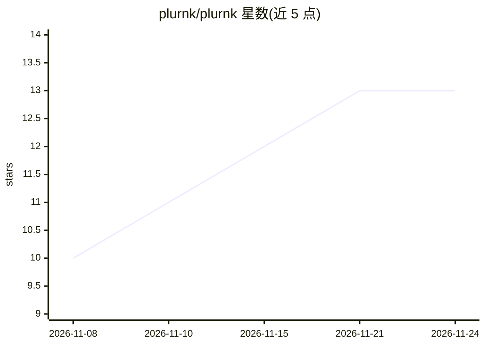

# plurnk/plurnk

⭐ 13 · TypeScript · MIT · 推送 2026-11-22 · [GitHub](https://github.com/plurnk/plurnk) · [官网](https://www.npmjs.com/package/@plurnk/plurnk) · 个人维护

**给开发者的终端编码 Agent：模型自策上下文与可组合工具**

提供 Unix CLI 与终端界面（Plurnk Term）及内建浏览器接口，连接 plurnk-service 守护进程使用。核心机制：模型每轮通过单一通用 `mcp` 工具发出并行调用，由虚拟机在统一地址空间执行并记录日志；上下文不做压缩，由模型持续策展；仓库入索后可用正则、XPath、JSONPath、全文与 tree-sitter 符号探索编辑。支持本地或云端模型、代理会话委派、SKILL.md 工作流蒸馏、变更提案默认需人工审阅。

## 筛选速览

| 维度 | 判定 | 备注 |
|---|---|---|
| AI 角色 | `ai-ecosystem` | LLM/agent 周边工具 |
| 许可风险 | `permissive` | MIT |
| 部署形态 | `library` | 以包/库形式分发 |
| 模型依赖 | — | README 未给出锁定关系 |
| 硬件要求 | — | 无带数字的原话,不猜 |
| 安装摩擦 | `low` | 无编译、无系统依赖或容器化 |
| 成熟度 | — | 结构信号不足 |

## 能力要点

- 模型驱动的持续上下文策展，不做压缩（perpetual context）
- 仓库全量索引后支持正则/XPath/JSONPath/tree-sitter 符号检索编辑
- 单一通用 `mcp` 工具承载每轮并行调用，边缘协议覆盖 ACPv2/MCP/Agent Skills
- CLI 一次性命令输出结构化 JSON（答案、操作轨迹、诊断、用量）

## 适用场景

- 在项目目录用自然语言交给 Agent 完成探索与修改任务
- 通过 git diff 管道让模型审查补丁正确性
- 把会话中的可复用流程蒸馏成 SKILL.md 技能
- 本地与云端模型之间按路由切换会话默认模型

## 场景标签

`编码 Agent` · 领域:编码与开发

## 证据(README 行号)

> L24: This repository provides the Unix CLI and Plurnk Term for
> L53: Give it a task in ordinary language. The model drives workspace operations
> L55: use Plurnk. If no model is configured on an

## 星数曲线

2026-11-08 10 → 2026-11-24 13（+3）

---
*卡片 v1 · prompt 1.4 · 生成 2026-11-18 · 置信度 high · 依据 README sha `b145cd398527` · [字段定义](../../DATASET.md)*
