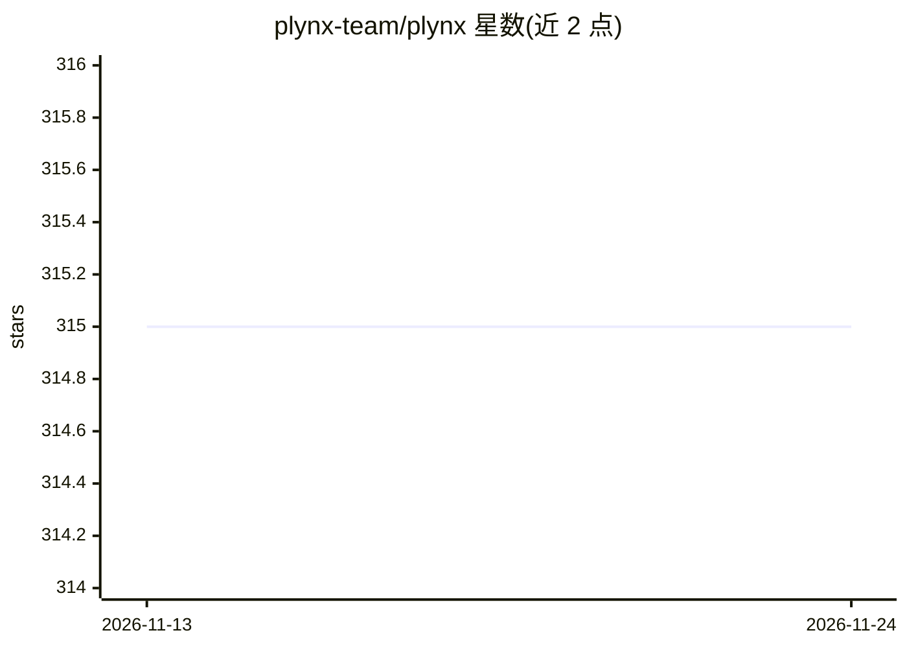

# plynx-team/plynx

⭐ — · [GitHub]() · 组织维护

**领域无关的可复现实验与数据工作流管理平台**

PLynx 是一个领域无关的实验管理与数据工作流平台：提供交互式图编辑器构建工作流、克隆与复现历史实验、自定义 Operation 插件、浏览器内监控中间结果与预览产出。执行引擎基于可扩展的 pub/sub 模型，Worker 可发布子任务回队列，支持从编译到集群部署等多种执行场景。元数据存储使用 MongoDB，工件存储支持 AWS S3、Google Cloud Storage 与文件系统。推荐通过 Docker 与 make 启动本地集群（含 MongoDB、UI、Backend、多个 Worker）。

## 筛选速览

| 维度 | 判定 | 备注 |
|---|---|---|
| AI 角色 | `ai-ecosystem` | LLM/agent 周边工具 |
| 许可风险 | `permissive` | — |
| 部署形态 | `library` | 以包/库形式分发 |
| 模型依赖 | — | README 未给出锁定关系 |
| 硬件要求 | — | 无带数字的原话,不猜 |
| 安装摩擦 | `low` | 无编译、无系统依赖或容器化 |
| 成熟度 | — | 结构信号不足 |

## 能力要点

- 交互式工作流图编辑器与实验历史克隆复现
- Operation 可独立于平台自定义与复用
- 基于 pub/sub 的可扩展执行引擎，Worker 支持子任务回投队列
- 元数据存 MongoDB，工件支持 S3/GCS/文件系统多种存储

## 适用场景

- 数据科学团队管理可复现的实验历史
- 以图形界面编排与监控多步骤工作流
- 在本地用 Docker 一键起集群跑工作流

## 场景标签

`工作流自动化` `MLOps` · 领域:效率与自动化

## 证据(README 行号)

> L13: PLynx is a domain agnostic platform for managing reproducible experiments and data-oriented workflows.
> L43: Execution Engine is based on scalable pub/sub model. Each Worker performs their jobs independently from each other 

## 星数曲线

2026-11-13 315 → 2026-11-24 315（+0）

---
*卡片 v1 · prompt 1.4 · 生成 2026-11-17 · 置信度 low · 依据 README sha `8af82005e085` · [字段定义](../../DATASET.md)*
