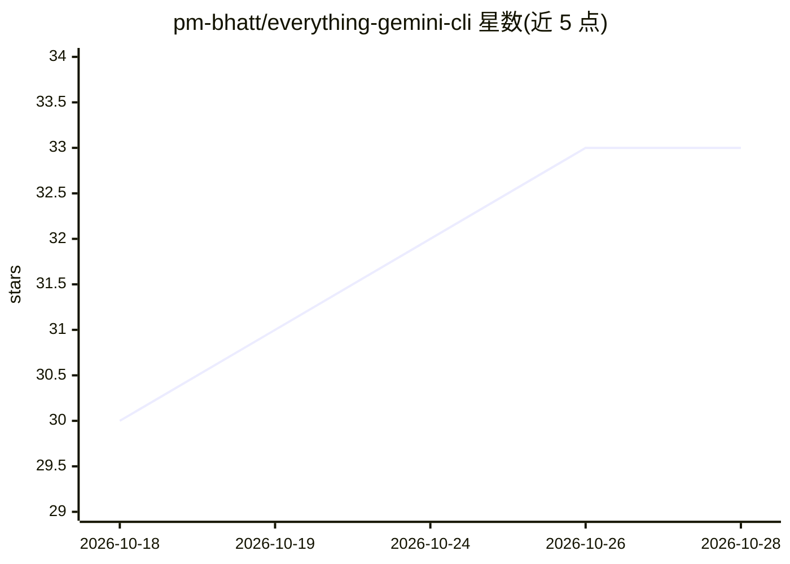

# pm-bhatt/everything-gemini-cli

⭐ 33 · NOASSERTION · 推送 2026-01-26 · [GitHub](https://github.com/pm-bhatt/everything-gemini-cli) · 个人维护

**面向 Gemini CLI 的开发命令/技能/规范扩展包**

从 everything-claude-code 移植而来的 Gemini CLI 扩展，包含 15 个预置命令（规划、TDD、代码审查、验证等）、14 个自动激活的技能（编码规范、前后端模式、安全审查、上下文管理等）以及安全/测试/git 规范合集。通过 gemini extensions install 一行命令安装，支持配置 GitHub/Supabase 等 MCP 服务器。文档列出 Claude Code 功能在 Gemini CLI 中的差异与变通方案。供使用 Gemini CLI 的开发者提升开发工作流。

## 筛选速览

| 维度 | 判定 | 备注 |
|---|---|---|
| AI 角色 | `ai-ecosystem` | LLM/agent 周边工具 |
| 许可风险 | `none` | NOASSERTION |
| 部署形态 | `None` |  |
| 模型依赖 | — | README 未给出锁定关系 |
| 硬件要求 | — | 无带数字的原话,不猜 |
| 安装摩擦 | `low` | 无编译、无系统依赖或容器化 |
| 成熟度 | — | 结构信号不足 |

## 能力要点

- 15 个预置命令：规划、TDD、代码审查、测试覆盖、多步编排等
- 14 个上下文感知技能，覆盖前后端模式、安全审查、上下文管理
- 内置 MCP 服务器配置（GitHub/Supabase 等）与环境变量说明
- 提供从 everything-claude-code 迁移的对照文档与功能差异表

## 适用场景

- 在 Gemini CLI 中使用 /tdd、/code-review 等工作流命令
- 为开发工作自动应用编码规范与安全审查最佳实践
- 配置 MCP 服务器扩展 CLI 的外部工具能力

## 场景标签

`提示工程` · 领域:Agent 开发

## 证据(README 行号)

> L3: A comprehensive Gemini CLI extension with commands, skills, and best practices for software development.
> L17: - **15 Commands**: Pre-configured workflows for planning, TDD, code review, testing, and more

## 星数曲线

2026-10-18 30 → 2026-10-28 33（+3）

---
*卡片 v1 · prompt 1.4 · 生成 2026-10-25 · 置信度 high · 依据 README sha `a28d77ca9b41` · [字段定义](../../DATASET.md)*
