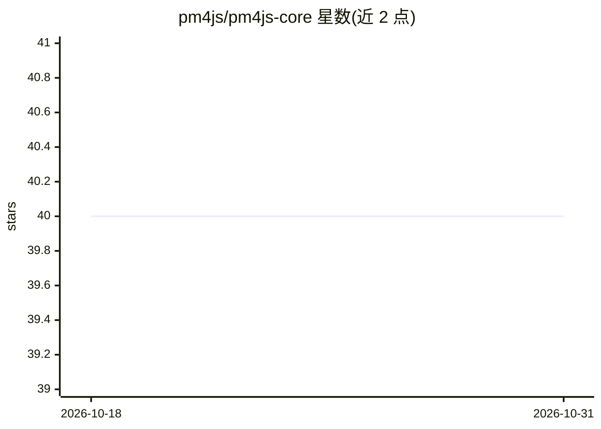

# pm4js/pm4js-core

⭐ 40 · JavaScript · BSD-3-Clause · 推送 2026-08-18 · [GitHub](https://github.com/pm4js/pm4js-core) · 组织维护

**JavaScript 流程挖掘库：从事件日志发现与检验流程模型**

在浏览器与 Node.js 中运行的流程挖掘核心库。支持导入/导出 XES、CSV、OCEL 事件日志，提供 Petri 网、流程树、DFG、BPMN 等模型对象的构建与可视化；算法层覆盖流程发现（Inductive Miner、Log Skeleton、时间画像）、一致性检验（Token 重放、对齐）、模型评估、日志过滤、仿真与特征提取，并附带 Celonis 连接器。以 npm 包或 dist 脚本形式安装，示例在 examples 目录中提供。

## 筛选速览

| 维度 | 判定 | 备注 |
|---|---|---|
| AI 角色 | `ai-native` | 本体是模型或模型工具 |
| 许可风险 | `permissive` | BSD-3-Clause |
| 部署形态 | `library` | 以包/库形式分发 |
| 模型依赖 | — | README 未给出锁定关系 |
| 硬件要求 | — | 无带数字的原话,不猜 |
| 安装摩擦 | `low` | 无编译、无系统依赖或容器化 |
| 成熟度 | — | 结构信号不足 |

## 能力要点

- 支持 XES/CSV/OCEL 事件日志的导入导出与统计
- 流程发现算法（Inductive Miner、Log Skeleton、Temporal Profile）
- 一致性检验（Token-Based Replay、多种对齐）与模型质量评估
- Petri 网/流程树/DFG/BPMN 的转换与可视化（vanilla Graphviz）

## 适用场景

- 从业务事件日志中发现流程模型
- 对事件日志与流程模型做一致性检验
- 对流程模型计算 fitness/precision/generalization 指标

## 场景标签

`数据分析` · 领域:效率与自动化

## 证据(README 行号)

> L64: 	* Process Discovery
> L66:  * Inductive Miner Directly Follows

## 星数曲线

2026-10-18 40 → 2026-10-31 40（+0）

---
*卡片 v1 · prompt 1.4 · 生成 2026-10-25 · 置信度 mid · 依据 README sha `fa7445c2733e` · [字段定义](../../DATASET.md)*
