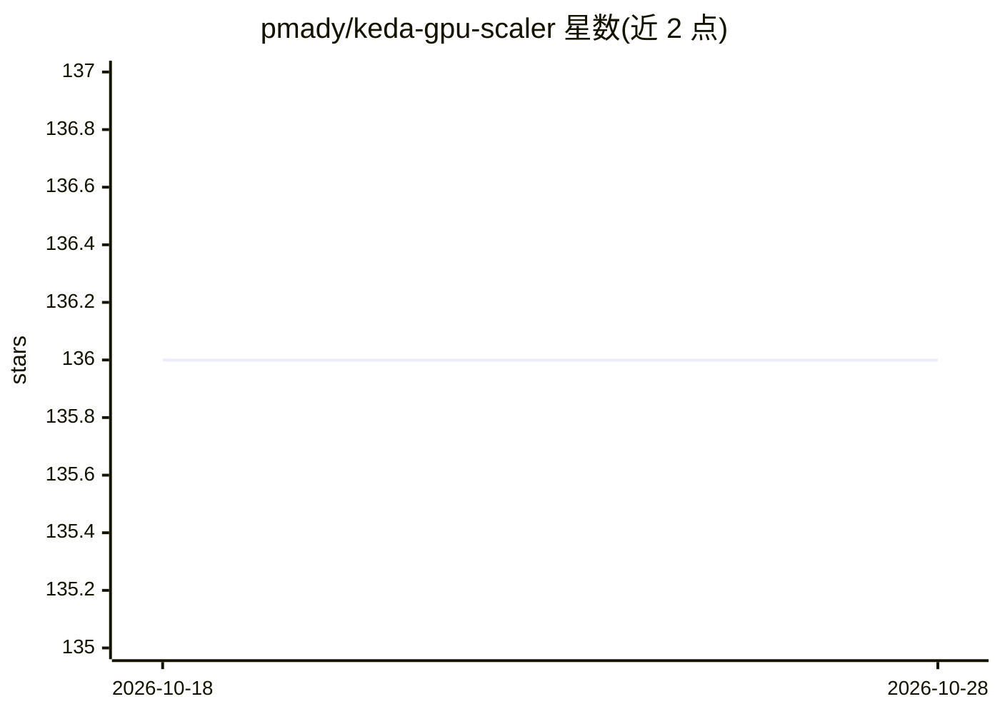

# pmady/keda-gpu-scaler

⭐ 136 · Go · Apache-2.0 · 推送 2026-10-28 · [GitHub](https://github.com/pmady/keda-gpu-scaler) · [官网](https://keda-gpu-scaler.readthedocs.io/en/latest/) · 个人维护

**KEDA 外部 gRPC 缩放器：用 NVML 原生 GPU 指标自动伸缩 K8s 推理负载**

以 DaemonSet 形式运行在 GPU 节点上，通过 go-nvml C 绑定直接读取 SM 利用率、显存、温度、功耗、PCIe/NVLink 吞吐及 vLLM/Triton 引擎指标，经 gRPC（ExternalScaler 协议）供 KEDA 操作器伸缩部署，支持缩容到零，无需 DCGM/Prometheus。提供 9 种预置伸缩 profile、可选 Prometheus 端点、gRPC/HTTP 探针，以及脱离 Kubernetes 使用的 gpu-metrics CLI（支持裸机/SLURM/Flux/Singularity）。限制：每个 DaemonSet pod 仅上报本节点指标，多节点聚合未实现；运行需 NVIDIA 驱动（libnvidia-ml.so）。

## 筛选速览

| 维度 | 判定 | 备注 |
|---|---|---|
| AI 角色 | `ai-ecosystem` | LLM/agent 周边工具 |
| 许可风险 | `permissive` | Apache-2.0 |
| 部署形态 | `self-host` | docker 或自建部署 |
| 模型依赖 | local-ok | 支持本地模型 |
| 硬件要求 | — | 无带数字的原话,不猜 |
| 安装摩擦 | `low` | 无编译、无系统依赖或容器化 |
| 成熟度 | — | 结构信号不足 |

## 能力要点

- NVML 直读 10+ GPU 硬件指标，经 gRPC 服务 KEDA，2 组件无抓取延迟
- 9 种预置 profile（vllm-inference/ollama/triton-inference/training 等）
- 支持 scale-to-zero、多 GPU 聚合（max/min/avg/sum/p95/p99）与冷却期
- 独立 gpu-metrics CLI 输出统一 JSON schema（裸机/SLURM/Flux/K8s/Singularity）

## 适用场景

- 在 Kubernetes 上按真实 GPU 利用率为 vLLM/Triton 推理服务自动伸缩
- 低负载时段将 GPU 推理负载缩容到零以节省成本
- 跨 SLURM/裸机/云环境采集统一格式的 GPU 指标

## 场景标签

`MLOps` · 领域:训练与推理

## 证据(README 行号)

> L9: A KEDA External Scaler that reads NVIDIA GPU metrics directly from NVML C-bindings and autoscales your vLLM, Triton,
> L41: 3. The pod serves `externalscaler.ExternalScalerServer` (`IsActive`, `StreamIsActive`, `GetMetricSpec`, `GetMetrics
> L90: - A Kubernetes cluster (e.g., **OKE**, GKE, EKS, AKS) with **NVIDIA GPU worker nodes**

## 星数曲线

2026-10-18 136 → 2026-10-28 136（+0）

---
*卡片 v1 · prompt 1.4 · 生成 2026-10-22 · 置信度 mid · 依据 README sha `bbe843f3caac` · [字段定义](../../DATASET.md)*
