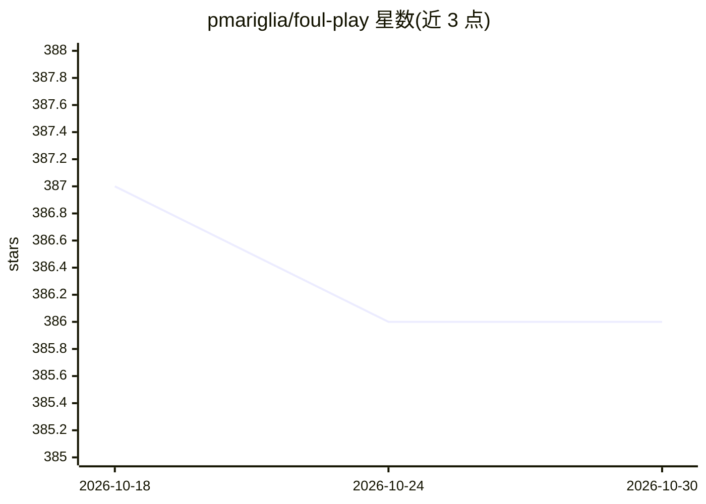

# pmariglia/foul-play

⭐ 386 · Python · GPL-3.0 · 推送 2026-10-12 · [GitHub](https://github.com/pmariglia/foul-play) · 个人维护

**在 Pokemon Showdown 平台自动打对战的宝可梦对战机器人**

通过 websocket 连接 Pokemon Showdown 服务器的对战 bot，支持各世代的单打对战（极巨化与 Z 招式暂不支持）。基于 poke-engine 引擎进行对战搜索，引擎为 Rust 编写，本地安装需先安装 Rust 从源码构建，可按世代重新编译引擎。配置通过命令行参数完成，以 bot-mode（如 search_ladder）参与排位对战。提供 Docker 镜像构建与运行方式。

## 筛选速览

| 维度 | 判定 | 备注 |
|---|---|---|
| AI 角色 | `ai-native` | 本体是模型或模型工具 |
| 许可风险 | `viral` | GPL-3.0 |
| 部署形态 | `self-host` | docker 或自建部署 |
| 模型依赖 | — | README 未给出锁定关系 |
| 硬件要求 | — | 无带数字的原话,不猜 |
| 安装摩擦 | `low` | 无编译、无系统依赖或容器化 |
| 成熟度 | — | 结构信号不足 |

## 能力要点

- 支持全世代单打对战（dynamax/z-moves 除外）
- 基于 Rust 编写的 poke-engine 进行对战搜索
- 可按世代重新编译引擎（--config-settings / make poke_engine）
- 提供 Docker 构建与运行流程

## 适用场景

- 让 bot 在 Pokemon Showdown 上自动打排位赛
- 研究宝可梦对战的搜索与决策引擎
- 针对特定世代定制引擎并本地运行

## 场景标签

 · 领域:游戏 AI/机器人

## 证据(README 行号)

> L2: A Pokémon battle-bot that can play battles on Pokemon Showdown.
> L76: This project uses poke-engine to search through battles.

## 星数曲线

2026-10-18 387 → 2026-10-30 386（-1）

---
*卡片 v1 · prompt 1.4 · 生成 2026-10-21 · 置信度 mid · 依据 README sha `15d4324e14ab` · [字段定义](../../DATASET.md)*
