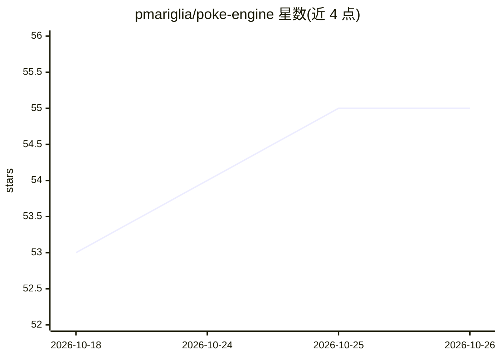

# pmariglia/poke-engine

⭐ 55 · Rust · MIT · 推送 2026-10-15 · [GitHub](https://github.com/pmariglia/poke-engine) · 个人维护

**宝可梦单打对战引擎：状态推演与搜索求最优招式**

用 Rust 编写的宝可梦单打对战引擎，通过状态字符串解析对战局面，支持按世代（4-8 代）条件编译。提供生成指令、伤害计算、expectiminimax 搜索（可 ab 剪枝）、迭代加深与蒙特卡洛树搜索等子命令，输出最优招式与评估值；另带交互模式可逐步应用/回退指令。README 自述并非完整引擎，覆盖度不及 PokemonShowdown。可直接运行二进制，也提供 Python 绑定。

## 筛选速览

| 维度 | 判定 | 备注 |
|---|---|---|
| AI 角色 | `ai-native` | 本体是模型或模型工具 |
| 许可风险 | `permissive` | MIT |
| 部署形态 | `library` | 以包/库形式分发 |
| 模型依赖 | — | README 未给出锁定关系 |
| 硬件要求 | — | 无带数字的原话,不猜 |
| 安装摩擦 | `low` | 无编译、无系统依赖或容器化 |
| 成熟度 | `idea` | |

## 能力要点

- expectiminimax（可 ab 剪枝）与蒙特卡洛树搜索输出最优招式
- 按世代条件编译，支持第 4-8 世代
- 交互模式支持状态应用/回退与评估
- 提供 Python 绑定

## 适用场景

- 为宝可梦对战 bot 提供状态推演与搜索核心
- 分析给定局面下双方招式的收益矩阵与最优选择
- 计算招式伤害随机数范围

## 场景标签

 · 领域:游戏/对战引擎

## 证据(README 行号)

> L3: An engine for searching through Pokémon battles (singles only).
> L60: 2. **Expectiminimax**
> L98: 4. **Monte Carlo Tree Search**

## 星数曲线

2026-10-18 53 → 2026-10-26 55（+2）

---
*卡片 v1 · prompt 1.4 · 生成 2026-10-24 · 置信度 mid · 依据 README sha `041954755032` · [字段定义](../../DATASET.md)*
