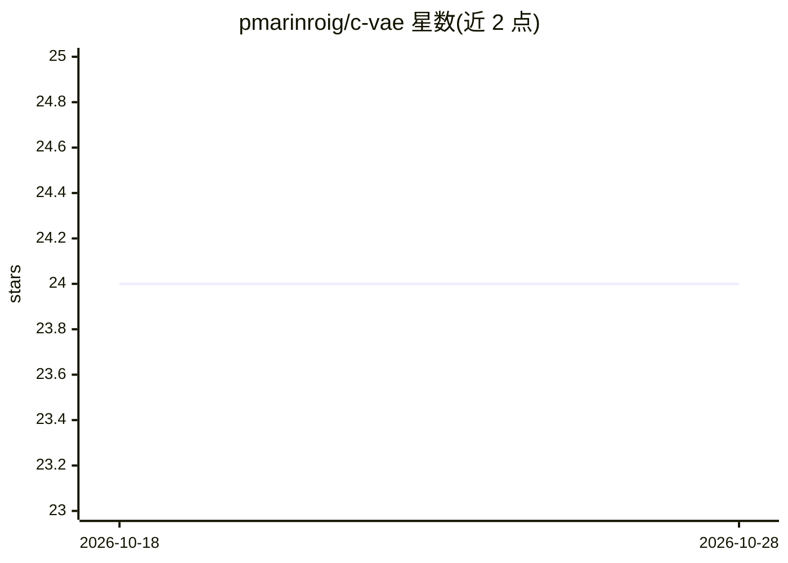

# pmarinroig/c-vae

⭐ 24 · C · 推送 2026-01-19 · [GitHub](https://github.com/pmarinroig/c-vae) · 个人维护

**纯 C 实现的卷积 VAE，用 Minecraft 贴图训练并生成图像**

用标准 C 从零实现的卷积变分自编码器，不依赖矩阵库或 ML 框架，自带 Conv2d/ConvTranspose2d/Affine/ReLU/Sigmoid 等层的前向与反向传播实现，通过 OpenMP 在 CPU 上多线程训练。训练数据为 16x16 的 Minecraft 物品贴图（低分辨率使其可在 CPU 上训练），训练后支持潜空间算术（如铁胸甲减'铁'概念加'钻石'概念生成钻石胸甲）。附带 pytorch_poc 目录的 PyTorch 同架构验证与 PNG 转二进制数据提取脚本。构建需 GCC 与 Make。

## 筛选速览

| 维度 | 判定 | 备注 |
|---|---|---|
| AI 角色 | `ai-native` | 本体是模型或模型工具 |
| 许可风险 | `none` | — |
| 部署形态 | `None` |  |
| 模型依赖 | — | README 未给出锁定关系 |
| 硬件要求 | — | 无带数字的原话,不猜 |
| 安装摩擦 | `low` | 无编译、无系统依赖或容器化 |
| 成熟度 | — | 结构信号不足 |

## 能力要点

- 纯标准 C 实现卷积 VAE，无外部矩阵库/ML 框架依赖
- 自实现多种层的 forward/backward 传播
- OpenMP CPU 多线程，i5-12400 上 500 epochs 约 11 分钟
- 潜空间概念算术生成新物品图像

## 适用场景

- 在 CPU 上训练并实验小型生成式模型
- 通过潜空间算术做物品图像概念变换
- 学习用纯 C 实现深度学习层与训练循环

## 场景标签

`图像生成` · 领域:内容生成

## 证据(README 行号)

> L3: A fully functional Convolutional VAE implemented in pure C from scratch. The VAE was trained using Minecraft item te
> L14: - **Custom Deep Learning Framework**: Implemented layers (Conv2d, ConvTranspose2d, Affine, ReLU, Sigmoid) with forw

## 星数曲线

2026-10-18 24 → 2026-10-28 24（+0）

---
*卡片 v1 · prompt 1.4 · 生成 2026-10-27 · 置信度 high · 依据 README sha `456cdcbbcd01` · [字段定义](../../DATASET.md)*
