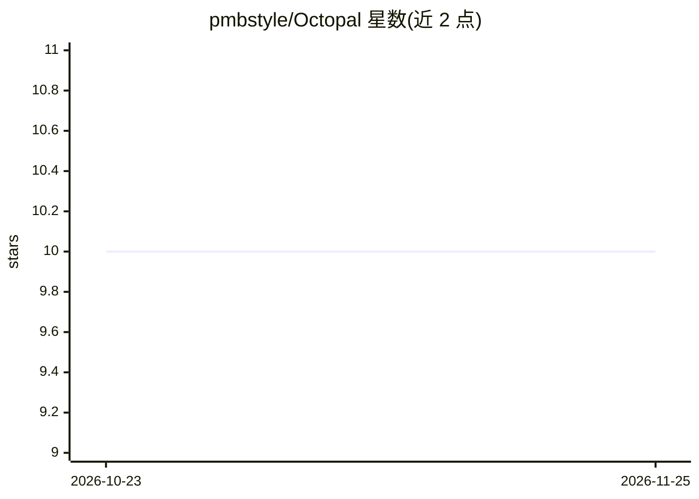

# pmbstyle/Octopal

⭐ 10 · Python · MIT · 推送 2026-08-16 · [GitHub](https://github.com/pmbstyle/Octopal) · [官网](https://octopal.ca) · 个人维护 · 中文 README

**本地运行的个人 AI 代理平台，隔离执行自动化任务**

Octopal 是一个可运行在个人电脑或服务器上的自主 AI 代理平台：长驻协调者 Octo 负责对话、记忆、策略与路由，将对外执行交给短生命周期的一次性 worker 子代理，worker 默认在 Docker 容器中隔离运行、不持有系统与私人上下文。用户通过 Telegram、WhatsApp 或桌面应用与之交互，支持定时任务、网页研究、MCP/A2A 集成、技能包、分层记忆与 token 保护的仪表盘。提供 Windows/macOS/Linux 桌面安装包与脚本/源码两种安装方式，嵌入检索使用本地 CPU-only ONNX 运行时。

## 筛选速览

| 维度 | 判定 | 备注 |
|---|---|---|
| AI 角色 | `ai-native` | 本体是模型或模型工具 |
| 许可风险 | `permissive` | MIT |
| 部署形态 | `desktop` | 安装包/桌面程序 |
| 模型依赖 | local-ok | 支持本地模型 |
| 硬件要求 | `cpu-ok` | |
| 安装摩擦 | `low` | 无编译、无系统依赖或容器化 |
| 成熟度 | — | 结构信号不足 |

## 能力要点

- 协调者/worker 分离架构，worker 在 Docker 容器中一次性运行并隔离删除
- 模型提供方可分别指定协调者与 worker 使用
- 12 种预置 worker 模板（网页研究、代码、测试、安全审计等）
- 分层记忆（MEMORY.md/canon/USER.md/SOUL.md/HEARTBEAT.md）与本地 ONNX 语义检索

## 适用场景

- 通过 Telegram/WhatsApp 让代理代为执行研究与信息汇总
- 托管定时报告、检查与提醒等例行自动化任务
- 以隔离 worker 运行代码、测试与仓库调查类工作
- 多代理通过 A2A 协作分工

## 场景标签

`AI 助手` `工作流自动化` `多智能体` · 领域:Agent 开发

## 证据(README 行号)

> L7: Octopal is your local autonomous AI agent - Octo, who can live on your computer or on a server. You can communicate 
> L13: Octo, as the main reasoning agent, lives inside your system and dedicates outside-world communication to specialize
> L88: Octopal lets you choose one model provider for Octo and, when useful, a different provider for workers. That makes 

## 星数曲线

2026-10-23 10 → 2026-11-25 10（+0）

---
*卡片 v1 · prompt 1.4 · 生成 2026-11-19 · 置信度 mid · 依据 README sha `97ae7fef027b` · [字段定义](../../DATASET.md)*
