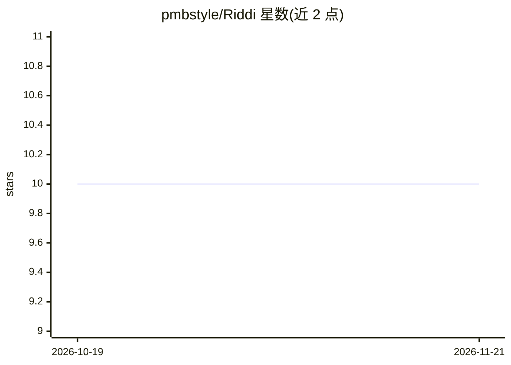

# pmbstyle/Riddi

⭐ 10 · TypeScript · MIT · 推送 2026-11-20 · [GitHub](https://github.com/pmbstyle/Riddi) · [官网](https://chromewebstore.google.com/detail/riddi/elghlgcjihgpmmffcmphbddmkgbfdbbg) · 个人维护

**Chrome 扩展：用本地 AI 模型朗读网页文章**

将网页文章转为语音的 Chrome 扩展：用 Readability.js 抽取正文并过滤导航与广告，通过浏览器内置 ONNX 模型（Supertonic 3）合成语音，全部在浏览器本地运行，不发送数据到外部服务器，无需 API key。支持自动检测文章语言、31 种语言、10 种内置音色、语速调节、朗读段落与逐词高亮及自动滚动，提供浮动播放控件、文本选区朗读与键盘快捷键。经 Chrome Web Store 分发，也可本地加载开发。

## 筛选速览

| 维度 | 判定 | 备注 |
|---|---|---|
| AI 角色 | `ai-native` | 本体是模型或模型工具 |
| 许可风险 | `permissive` | MIT |
| 部署形态 | `None` |  |
| 模型依赖 | — | README 未给出锁定关系 |
| 硬件要求 | — | 无带数字的原话,不猜 |
| 安装摩擦 | `low` | 无编译、无系统依赖或容器化 |
| 成熟度 | — | 结构信号不足 |

## 能力要点

- ONNX Runtime Web 本地推理（WebGPU，WASM 回退），加载后可离线使用
- Supertonic 3 支持 31 种语言、10 种音色、0.5x–2x 语速与去噪步数质量调节
- Readability.js 自动抽取正文，另支持手动选择文本块朗读
- 朗读进度段落高亮、逐词高亮与自动滚动

## 适用场景

- 做其他事情时听网页文章
- 无障碍场景下朗读任意网页内容
- 免提收听学习资料
- 减少长时间阅读屏幕的视觉疲劳

## 场景标签

`语音合成` · 领域:内容生成

## 证据(README 行号)

> L5: A Chrome extension that converts web articles to speech using built-in local AI models. No cloud services, no API ke
> L23: - Runs entirely in your browser using ONNX Runtime (WebGPU with WASM fallback)
> L38: - Uses Supertonic 3 with local support for 31 languages

## 星数曲线

2026-10-19 10 → 2026-11-21 10（+0）

---
*卡片 v1 · prompt 1.4 · 生成 2026-11-19 · 置信度 high · 依据 README sha `cc4b033dfcc1` · [字段定义](../../DATASET.md)*
