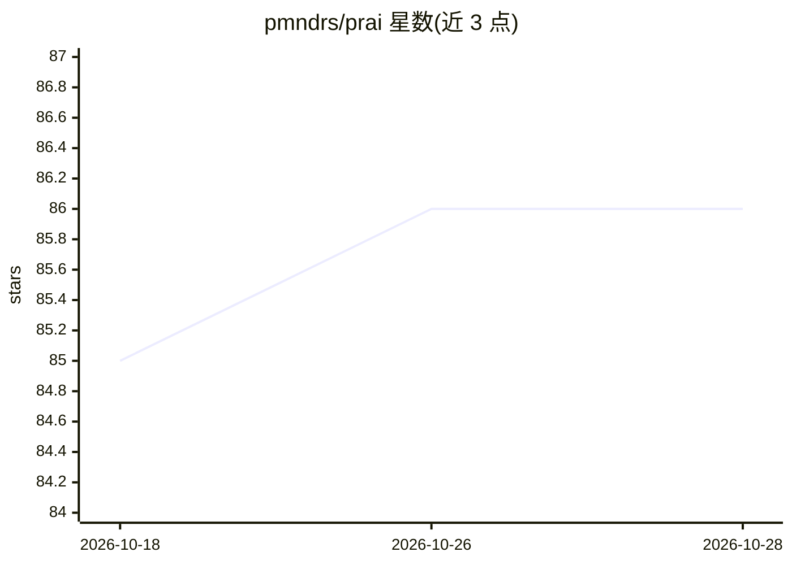

# pmndrs/prai

⭐ 86 · TypeScript · MIT · 推送 2026-10-02 · [GitHub](https://github.com/pmndrs/prai) · [官网](https://pmndrs.github.io/prai/) · 组织维护

**用 TypeScript 代码构建分步 LLM 指令的 JS 框架**

面向 JavaScript/TypeScript 开发者的 LLM 提示词工程框架：将多步骤提示转为结构化、可维护、可调试的代码，提供 step 构建块（含 mapStep/filterStep 等数据处理步骤）、支持 OpenAI、Groq、Gemini 与 mock 的模型抽象层，以及会话历史追踪与多模态支持；另覆盖流式响应、条件工作流、模型回退与测试策略。通过 npm 安装。README 中仍有 TODO 项（日志写出、步骤选项覆盖响应与成本字段）。

## 筛选速览

| 维度 | 判定 | 备注 |
|---|---|---|
| AI 角色 | `ai-ecosystem` | LLM/agent 周边工具 |
| 许可风险 | `permissive` | MIT |
| 部署形态 | `library` | 以包/库形式分发 |
| 模型依赖 | — | README 未给出锁定关系 |
| 硬件要求 | — | 无带数字的原话,不猜 |
| 安装摩擦 | `low` | 无编译、无系统依赖或容器化 |
| 成熟度 | — | 结构信号不足 |

## 能力要点

- 提示词转为结构化 TypeScript 代码（step 构建块 + schema 集成）
- 模型抽象层支持 OpenAI、Groq、Gemini 与 mock providers
- History 会话追踪、引用系统、子任务与多模态支持
- 支持流式响应、条件工作流、模型回退与测试策略

## 适用场景

- 将多步骤、多格式的自然语言提示改写为可维护代码
- 构建带 schema 校验的分步 LLM 工作流
- 在多个模型供应商间抽象与切换

## 场景标签

`提示工程` `Agent 框架` · 领域:Agent 开发

## 证据(README 行号)

> L2:  JS Framework for building step-by-step LLM instructions (<ins>pr</ins>ogrammable <ins>ai</ins>)
> L19: With **prai**, prompts become code—structured, maintainable, and debuggable—leading to high-quality, reliable outpu
> L47: - **Models** - AI provider abstraction supporting OpenAI, Groq, Gemini, and mock providers

## 星数曲线

2026-10-18 85 → 2026-10-28 86（+1）

---
*卡片 v1 · prompt 1.4 · 生成 2026-10-24 · 置信度 high · 依据 README sha `f9c7c368bff1` · [字段定义](../../DATASET.md)*
