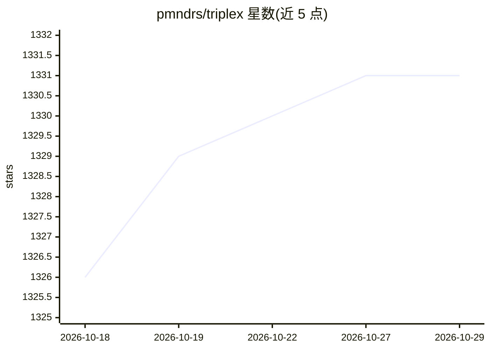

# pmndrs/triplex

⭐ 1,331 · TypeScript · 推送 2026-06-11 · [GitHub](https://github.com/pmndrs/triplex) · [官网](https://triplex.dev) · 组织维护

**React / Three Fiber 的开源可视化场景编辑工作台**

以 VS Code 扩展形式提供的可视化工作区：用户通过可视控件与输入面板搭建 React Three Fiber 的 2D/3D 组件，需要时可下钻到代码；支持从起始模板新建项目或打开现有工程。面向使用 React 与 Three.js 构建 2D/3D Web 内容的开发者，由 Poimandres 社区维护，文档与社区渠道见 triplex.dev。README 未描述 AI 相关功能的实现细节。

## 筛选速览

| 维度 | 判定 | 备注 |
|---|---|---|
| AI 角色 | `ai-enhanced` | 去掉 AI 部分产品仍成立 |
| 许可风险 | `none` | — |
| 部署形态 | `None` |  |
| 模型依赖 | — | README 未给出锁定关系 |
| 硬件要求 | — | 无带数字的原话,不猜 |
| 安装摩擦 | `low` | 无编译、无系统依赖或容器化 |
| 成熟度 | — | 结构信号不足 |

## 能力要点

- 可视化控件搭建 React / Three Fiber 2D/3D 组件
- 以 VS Code 扩展形式安装使用
- 支持起始模板或打开现有项目
- 可随时从可视化编辑下钻到代码

## 适用场景

- 在 VS Code 里可视化搭建 Three Fiber 场景
- 用模板快速启动 React 3D 项目
- 调节 3D 组件参数后回到代码继续开发

## 场景标签

 · 领域:Web 前端/3D 开发工具

## 证据(README 行号)

> L3: Triplex is the open source visual workspace for building React / Three Fiber components. Build 2D and 3D components 

## 星数曲线

2026-10-18 1,326 → 2026-10-29 1,331（+5）

---
*卡片 v1 · prompt 1.4 · 生成 2026-10-21 · 置信度 low · 依据 README sha `d25135657890` · [字段定义](../../DATASET.md)*
