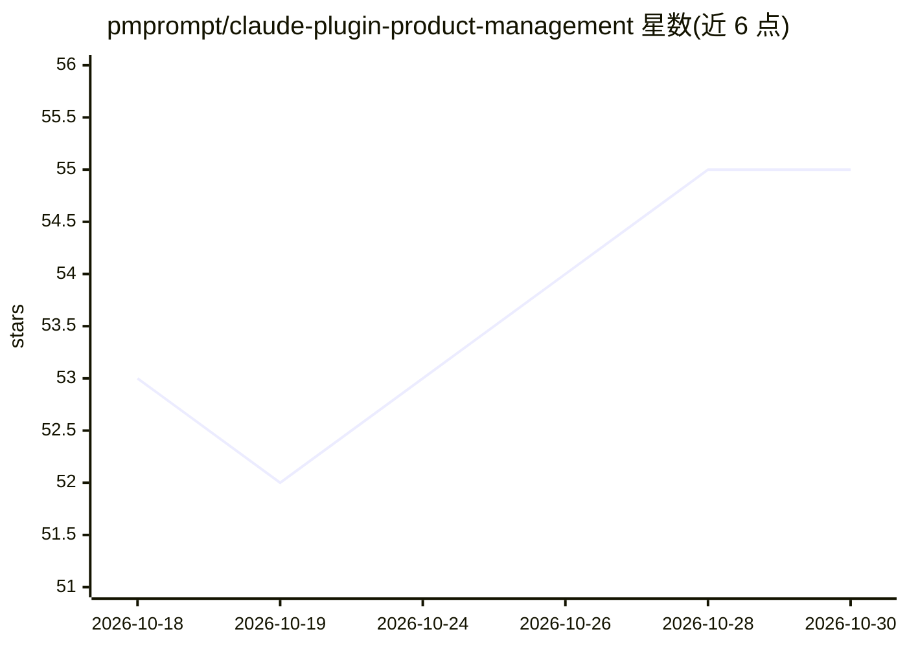

# pmprompt/claude-plugin-product-management

⭐ 55 · Python · MIT · 推送 2026-10-22 · [GitHub](https://github.com/pmprompt/claude-plugin-product-management) · [官网](https://pmprompt.com/claude-product-management-plugin) · 组织维护

**面向产品经理的 Claude 插件：30 个 PM 技能/命令包**

开源的 Claude 插件，将产品管理技能与命令打包，安装一次即可跨项目复用。收录约 30 个技能，覆盖 PRD 撰写、用户故事生成、RICE 优先级排序、PMF 调研、OKR 规划、定位画布等，并以经典方法论（JTBD、Shape Up、Hooked 模型等）为依据生成文档。可运行于 Claude 插件目录、Cowork plugins、Claude Code 及 Codex，通过 Skills CLI（npx）、git clone、插件市场命令或 Codex marketplace 多种方式安装。

## 筛选速览

| 维度 | 判定 | 备注 |
|---|---|---|
| AI 角色 | `ai-ecosystem` | LLM/agent 周边工具 |
| 许可风险 | `permissive` | MIT |
| 部署形态 | `library` | 以包/库形式分发 |
| 模型依赖 | locked-api |  |
| 硬件要求 | — | 无带数字的原话,不猜 |
| 安装摩擦 | `low` | 无编译、无系统依赖或容器化 |
| 成熟度 | — | 结构信号不足 |

## 能力要点

- 约 30 个产品管理技能，以 /pmprompt 命名空间调用
- 兼容 Claude 插件目录、Cowork、Claude Code 与 Codex
- 提供 npx skills、git clone、/plugin、Codex marketplace 四种安装途径

## 适用场景

- 把功能想法整理成可交付的 PRD 与用户故事
- 用 RICE、OKR 等框架做优先级与季度规划
- 撰写利益相关者进展更新与定位文档

## 场景标签

`AI 写作` · 领域:内容生成

## 证据(README 行号)

> L3: A free / open source **Claude plugin for product managers**.
> L20: Plugins bundle skills/commands so you can install them once and reuse them across projects.

## 星数曲线

2026-10-18 53 → 2026-10-30 55（+2）

---
*卡片 v1 · prompt 1.4 · 生成 2026-10-24 · 置信度 high · 依据 README sha `b6f44d9da7b8` · [字段定义](../../DATASET.md)*
