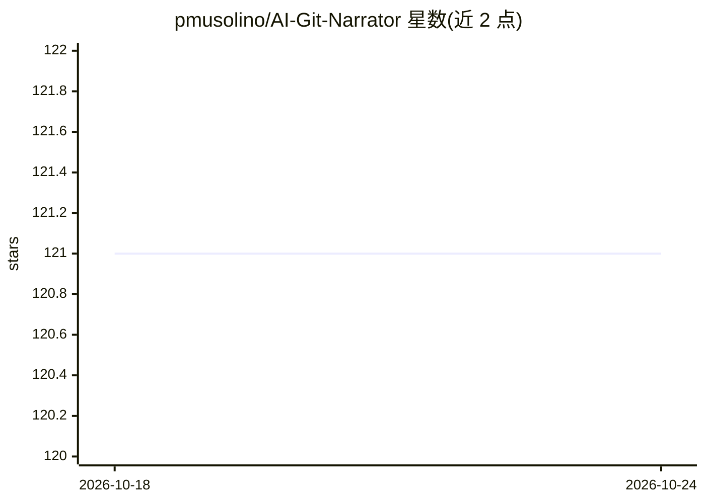

# pmusolino/AI-Git-Narrator

⭐ 121 · Swift · MIT · 推送 2026-01-18 · [GitHub](https://github.com/pmusolino/AI-Git-Narrator) · 个人维护

**macOS 命令行工具：用 AI 生成 Git 提交信息与 PR 描述**

Swift 编写的 macOS 命令行工具，读取 Git diff 与提交历史，调用 OpenAI GPT、Google Gemini 或 Ollama 本地模型生成提交信息（支持全部/暂存/未暂存变更三种模式）与 PR 标题描述。可配置模型、温度、最大 token、超时与 Ollama 地址；使用 Ollama 时无需 API key，模型本地运行。通过 Homebrew 安装，源码构建需 Swift 6.x，仅支持 macOS。

## 筛选速览

| 维度 | 判定 | 备注 |
|---|---|---|
| AI 角色 | `ai-native` | 本体是模型或模型工具 |
| 许可风险 | `permissive` | MIT |
| 部署形态 | `None` |  |
| 模型依赖 | local-ok | 支持本地模型 |
| 硬件要求 | — | 无带数字的原话,不猜 |
| 安装摩擦 | `low` | 无编译、无系统依赖或容器化 |
| 成熟度 | — | 结构信号不足 |

## 能力要点

- 基于全部/暂存/未暂存变更生成提交信息
- 支持 OpenAI、Gemini、Ollama 三类提供方
- 模型、温度、token 上限、超时等参数可配置
- Ollama 本地模式无需 API key 且可离线使用

## 适用场景

- 我不想手写提交信息，让 AI 根据 diff 自动生成
- 根据提交历史自动生成 PR 描述
- 用本地 Ollama 模型生成提交信息，代码不出本机

## 场景标签

`AI 写作` · 领域:内容生成

## 证据(README 行号)

> L8: AI Git Narrator is a command-line tool that leverages OpenAI's GPT models, Google's Gemini models, and Ollama's loca
> L23: - **Generate Commit Messages**: Automatically generate commit messages based on all changes, staged changes, or uns
> L24: - **Generate PR Descriptions**: Create detailed pull request descriptions based on your commit history.

## 星数曲线

2026-10-18 121 → 2026-10-24 121（+0）

---
*卡片 v1 · prompt 1.4 · 生成 2026-10-23 · 置信度 high · 依据 README sha `1a0b2e6b9028` · [字段定义](../../DATASET.md)*
