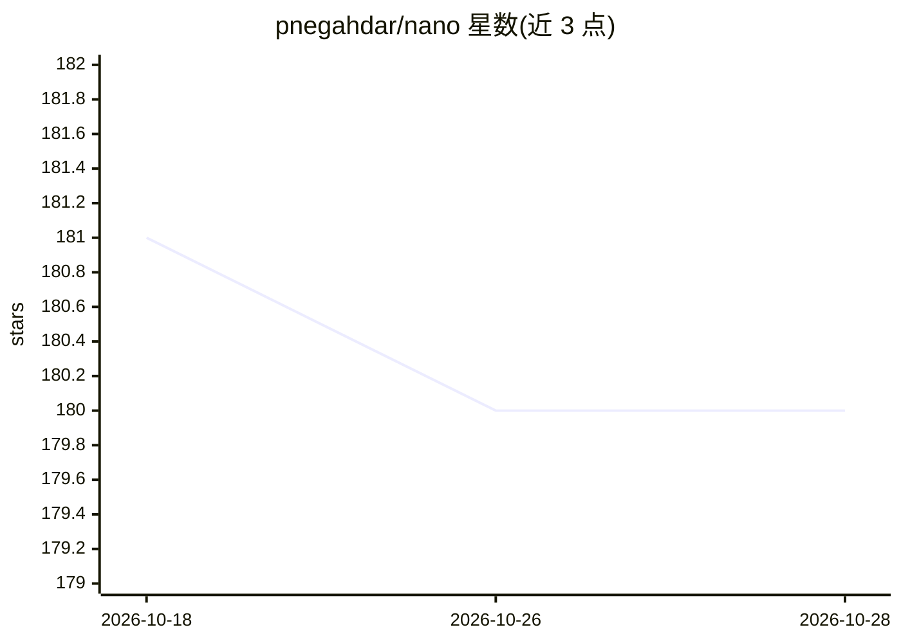

# pnegahdar/nano

⭐ 180 · Python · 推送 2026-05-17 · [GitHub](https://github.com/pnegahdar/nano) · 个人维护

**单文件零依赖的命令行编码 Agent：读仓库、执行命令、修复任务**

用不到 200 行纯 Python 标准库实现的编码 Agent：读取 CLAUDE.md/AGENT.md 等仓库上下文与 SKILL.md 技能文件，将上下文发送给 OpenAI Responses API（默认 gpt-5.5，可用环境变量换模型），模型请求的 shell 命令经人工批准后执行，循环至多 200 步直至任务完成。提供交互式 REPL、一次性 CLI、会话恢复（会话存储在 OpenAI 侧）。不做包安装、配置文件、Docker 与插件系统。面向想理解 Agent 内部机制的开发者。

## 筛选速览

| 维度 | 判定 | 备注 |
|---|---|---|
| AI 角色 | `ai-native` | 本体是模型或模型工具 |
| 许可风险 | `none` | — |
| 部署形态 | `None` |  |
| 模型依赖 | — | README 未给出锁定关系 |
| 硬件要求 | — | 无带数字的原话,不猜 |
| 安装摩擦 | `low` | 无编译、无系统依赖或容器化 |
| 成熟度 | — | 结构信号不足 |

## 能力要点

- 单文件、低于 200 行、零依赖，纯 Python 标准库
- 读取 CLAUDE.md/AGENT.md 上下文并发现 SKILL.md 技能文件
- 命令级人工审批（逐条/全部/自动模式），输出上限 12KB
- REPL 多轮对话、一次性 CLI、会话恢复（-c）与会话选择（-s）

## 适用场景

- 让 Agent 在我的仓库里跑测试并修复失败项
- 以可审计的最小实现学习编码 Agent 的运行循环
- 通过多轮 REPL 会话完成一系列编码任务

## 场景标签

`编码 Agent` · 领域:编码与开发

## 证据(README 行号)

> L38: `nano.py` is that loop. It sends context to GPT-5.5, lets it run shell commands,
> L22: > 🔁 **200-step agentic loop** — keeps going until the job is done, not until it gets bored

## 星数曲线

2026-10-18 181 → 2026-10-28 180（-1）

---
*卡片 v1 · prompt 1.4 · 生成 2026-10-22 · 置信度 high · 依据 README sha `ea5ec7ab291b` · [字段定义](../../DATASET.md)*
