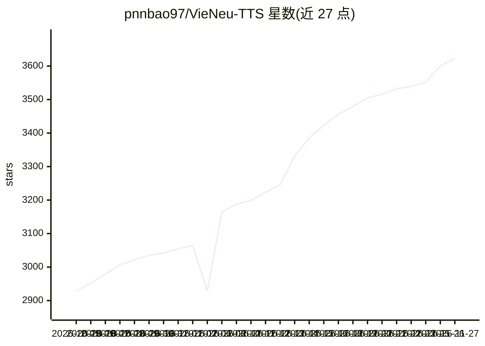

# pnnbao97/VieNeu-TTS

⭐ 3,624 · Python · Apache-2.0 · 推送 2026-11-26 · [GitHub](https://github.com/pnnbao97/VieNeu-TTS) · [官网](https://www.vieneu.io) · 个人维护

**越南语端侧语音合成：即时音色克隆与实时 CPU 推理**

基于 10,000+ 小时双语数据训练的越南语 TTS 模型与 SDK：支持 3–8 秒参考片段的即时音色克隆（含自动去噪）、25 个内置预设音色（北/中/南三个地区）、文本内联情感标签、批量与多说话人对话生成。CPU 路径经 ONNX Runtime 运行且不依赖 PyTorch，GPU 路径用 PyTorch 批量推理，另提供流式输出、OpenAI 兼容 API、Docker 部署、LoRA 微调与 Gradio Web UI。v3 Turbo 为本仓库开源版本；v4 为闭源，仅经官方 API 提供。

## 筛选速览

| 维度 | 判定 | 备注 |
|---|---|---|
| AI 角色 | `ai-native` | 本体是模型或模型工具 |
| 许可风险 | `permissive` | Apache-2.0 |
| 部署形态 | `self-host` | docker 或自建部署 |
| 模型依赖 | — | README 未给出锁定关系 |
| 硬件要求 | `cpu-ok` | |
| 安装摩擦 | `low` | 无编译、无系统依赖或容器化 |
| 成熟度 | — | 结构信号不足 |

## 能力要点

- 3–8 秒参考片段即时音色克隆，含自动去噪与音色注册复用
- CPU 经 ONNX Runtime 推理，默认安装不依赖 PyTorch；提供 int8 与 v3 Nano 提速变体
- OpenAI 兼容流式 API（POST /v1/audio/speech），兼容 OpenAI SDK / Pipecat / LiveKit
- 支持 LoRA 微调、批量生成（batch ≤32）与多说话人对话模式

## 适用场景

- 把越南语文本转成指定音色的语音
- 用几秒钟自己的录音克隆音色并注册复用
- 搭建本地流式语音合成 API 服务
- 在消费级 GPU 上微调自己的朗读音色

## 场景标签

`语音合成` `微调` · 领域:内容生成

## 证据(README 行号)

> L13: **VieNeu-TTS** is the next generation of on-device Vietnamese TTS: **10,000+ hours** of bilingual training, **insta
> L116: The `vieneu` SDK **defaults to VieNeu-TTS v3 Turbo (48 kHz)**. The minimal install is **torch-free**: on CPU every

## 星数曲线

2026-10-25 2,929 → 2026-11-27 3,624（+695）

---
*卡片 v1 · prompt 1.4 · 生成 2026-11-27 · 置信度 high · 依据 README sha `5fa03eeb46d0` · [字段定义](../../DATASET.md)*
