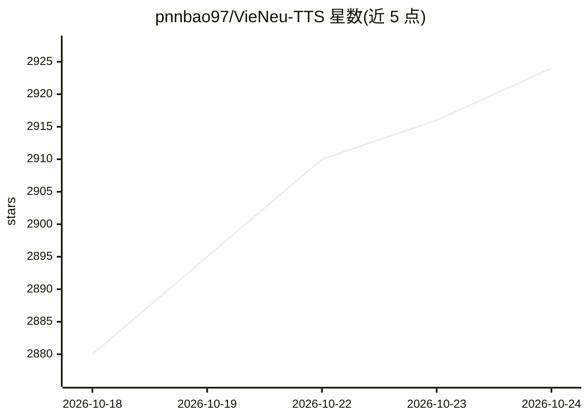

# pnnbao97/VieNeu-TTS

⭐ 2,929 · Python · Apache-2.0 · 推送 2026-10-20 · [GitHub](https://github.com/pnnbao97/VieNeu-TTS) · [官网](https://www.vieneu.io) · 个人维护

**越南语设备端 TTS：即时声音克隆、实时流式合成**

面向越南语的文本转语音模型与 Python SDK：v3 Turbo 版本输出 48 kHz 音频，内置 25 个预设音色（覆盖北/中/南三地区），支持从 3–8 秒参考音频即时克隆声音并自动降噪，支持实验性情感标记、多说话者对话批量生成与 LoRA 微调。CPU 路径基于 ONNX Runtime 免 PyTorch，GPU 路径用 PyTorch 自动批处理，提供 OpenAI 兼容流式 API（POST /v1/audio/speech）与 Docker 部署。v4 版本专有不开源，仅经 vieneu.io API 提供；本仓库开源版本为 v3 Turbo。

## 筛选速览

| 维度 | 判定 | 备注 |
|---|---|---|
| AI 角色 | `ai-native` | 本体是模型或模型工具 |
| 许可风险 | `permissive` | Apache-2.0 |
| 部署形态 | `self-host` | docker 或自建部署 |
| 模型依赖 | — | README 未给出锁定关系 |
| 硬件要求 | `cpu-ok` | |
| 安装摩擦 | `low` | 无编译、无系统依赖或容器化 |
| 成熟度 | — | 结构信号不足 |

## 能力要点

- 48 kHz 音频、25 个预设音色（北/中/南三地区）
- 3–8 秒参考音频即时声音克隆，自动降噪
- CPU 走 ONNX Runtime 免 PyTorch，GPU 支持批处理与流式（首音频约 115 ms）
- OpenAI 兼容流式 API（/v1/audio/speech）与 Docker 部署、LoRA 微调

## 适用场景

- 为应用生成越南语语音或克隆指定音色
- 通过 OpenAI SDK / Pipecat / LiveKit 接入流式语音合成
- 在无 GPU 的 CPU 设备上实时合成越南语语音

## 场景标签

`语音合成` · 领域:内容生成

## 证据(README 行号)

> L13: **VieNeu-TTS** is the next generation of on-device Vietnamese TTS: **10,000+ hours** of bilingual training, **insta
> L33: > - **Real-time streaming + OpenAI-compatible API + Docker** — `POST /v1/audio/speech` drop-in for the OpenAI SDK /

## 星数曲线

2026-10-18 2,880 → 2026-10-24 2,924（+44）

---
*卡片 v1 · prompt 1.4 · 生成 2026-10-21 · 置信度 high · 依据 README sha `645219fde3cd` · [字段定义](../../DATASET.md)*
