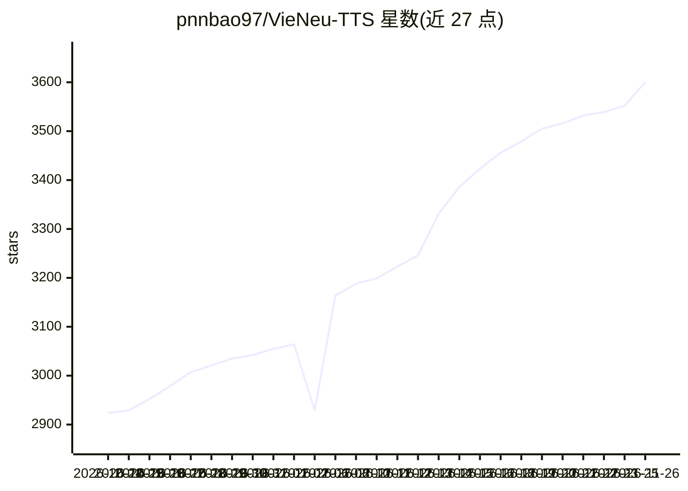

# pnnbao97/VieNeu-TTS

⭐ 3,600 · Python · Apache-2.0 · 推送 2026-11-24 · [GitHub](https://github.com/pnnbao97/VieNeu-TTS) · [官网](https://www.vieneu.io) · 个人维护

**面向越南语开发者的端侧文本转语音与即时声音克隆库**

VieNeu-TTS 提供越南语文本转语音与 3–8 秒参考音频的即时声音克隆，含 25 个南北中三区预置音色、批量生成、逐帧实时流式输出与情感标记（实验性）。CPU 路径基于 ONNX Runtime 运行且无需 PyTorch，GPU 路径用 PyTorch 自动批处理；另提供 OpenAI 兼容的 /v1/audio/speech 流式 API、Docker 部署、Gradio Web UI、Python SDK 与 LoRA 微调。配音/播客等功能仅存在于官方闭源 App；v4 为专有闭源版本，仅通过 API 提供，本仓库开源最新版本为 v3 Turbo。

## 筛选速览

| 维度 | 判定 | 备注 |
|---|---|---|
| AI 角色 | `ai-native` | 本体是模型或模型工具 |
| 许可风险 | `permissive` | Apache-2.0 |
| 部署形态 | `self-host` | docker 或自建部署 |
| 模型依赖 | — | README 未给出锁定关系 |
| 硬件要求 | `cpu-ok` | |
| 安装摩擦 | `low` | 无编译、无系统依赖或容器化 |
| 成熟度 | — | 结构信号不足 |

## 能力要点

- 3–8 秒参考音频即时声音克隆，自动降噪并截取
- CPU 端 torch-free 推理（ONNX Runtime），GPU 批处理 RTF ≈ 0.02
- OpenAI 兼容流式 API，兼容 OpenAI SDK / Pipecat / LiveKit
- LoRA 微调支持在消费级 GPU 上训练自定义音色

## 适用场景

- 为越南语应用生成 48 kHz 语音旁白
- 用几秒参考音频克隆特定说话人音色
- 部署 OpenAI 兼容的实时流式 TTS 服务
- 在消费级 GPU 上 LoRA 微调自己的声音

## 场景标签

`语音合成` `微调` · 领域:内容生成

## 证据(README 行号)

> L13: **VieNeu-TTS** is the next generation of on-device Vietnamese TTS: **10,000+ hours** of bilingual training, **insta
> L35: > - **Real-time streaming + OpenAI-compatible API + Docker** — `POST /v1/audio/speech` drop-in for the OpenAI SDK /
> L116: The `vieneu` SDK **defaults to VieNeu-TTS v3 Turbo (48 kHz)**. The minimal install is **torch-free**: on CPU every

## 星数曲线

2026-10-24 2,924 → 2026-11-26 3,600（+676）

---
*卡片 v1 · prompt 1.4 · 生成 2026-11-26 · 置信度 high · 依据 README sha `e987b9c071af` · [字段定义](../../DATASET.md)*
