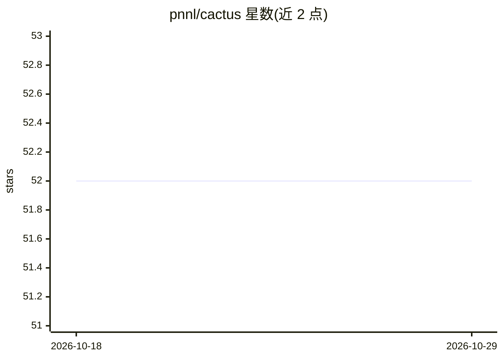

# pnnl/cactus

⭐ 52 · Jupyter Notebook · BSD-2-Clause · 推送 2026-04-07 · [GitHub](https://github.com/pnnl/cactus) · 组织维护

**给化学家的 LLM Agent：调用化学信息学工具回答分子问题**

由 PNNL 研究者开发的工具增强型语言模型 Agent，将 LLM 与 RDKit 类化学信息学工具结合，面向研究人员与化学家，用于探索化学空间、预测分子性质与辅助药物发现。提供分子量、LogP、TPSA、QED、类药性、Lipinski 规则、Brenk/PAINS 过滤等工具，工具当前以 SMILES 为输入，标识符转换工具尚未正常工作。默认 PyTorch 按 CUDA 12.1（或 CPU）编译，仅支持 Python 3.10-3.12，附基准问题生成脚本与 HuggingFace Spaces 演示。

## 筛选速览

| 维度 | 判定 | 备注 |
|---|---|---|
| AI 角色 | `ai-native` | 本体是模型或模型工具 |
| 许可风险 | `permissive` | BSD-2-Clause |
| 部署形态 | `library` | 以包/库形式分发 |
| 模型依赖 | local-ok | 支持本地模型 |
| 硬件要求 | — | 无带数字的原话,不猜 |
| 安装摩擦 | `medium` | 含编译或系统依赖之一 |
| 成熟度 | — | 结构信号不足 |

## 能力要点

- LLM Agent 调用 10 种化学信息学工具（分子量/LogP/QED/类药性等）
- 支持 llama2/3、mistral、gemma、falcon、Phi 等模型后端，可用 vllm 运行
- 提供基准数据集生成脚本与 HuggingFace Spaces 演示

## 适用场景

- 通过对话查询 SMILES 分子的理化性质与类药性
- 批量生成化学基准问题评测 Agent 表现
- 药物发现流程中做分子过滤（Lipinski/Brenk/PAINS）

## 场景标签

`科研工具` `聊天机器人` · 领域:对话与助手

## 证据(README 行号)

> L14: CACTUS is an innovative tool-augmented language model designed to assist researchers and chemists in various chemis
> L30: Model.run("What is the molecular weight of the smiles: OCC1OC(O)C(C(C1O)O)O")
> L95: For the initial release, we have simple cheminformatics tools available:

## 星数曲线

2026-10-18 52 → 2026-10-29 52（+0）

---
*卡片 v1 · prompt 1.4 · 生成 2026-10-24 · 置信度 high · 依据 README sha `1551611f4ae3` · [字段定义](../../DATASET.md)*
