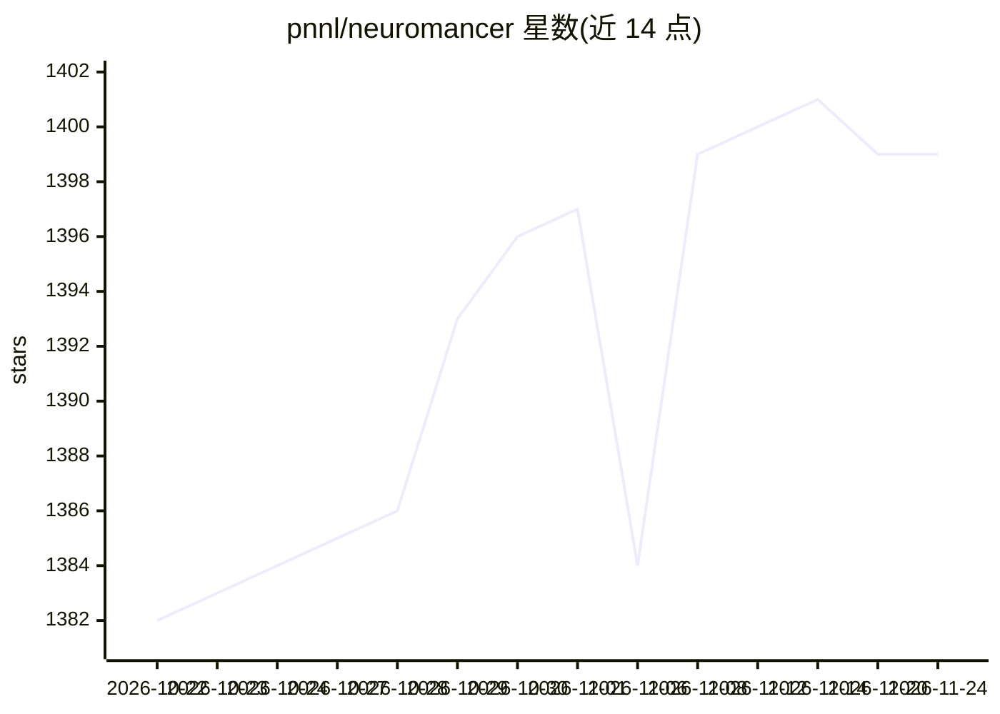

# pnnl/neuromancer

⭐ 1,399 · Python · NOASSERTION · 推送 2026-10-22 · [GitHub](https://github.com/pnnl/neuromancer) · [官网](https://pnnl.github.io/neuromancer/) · 组织维护

**面向科研的参数化约束优化与物理信息控制 PyTorch 库**

NeuroMANCER 是基于 PyTorch 的可微分编程库，用于求解参数化约束优化问题、物理信息系统辨识和参数化模型预测控制。它提供符号编程接口，将物理方程、领域知识和约束嵌入学习范式，覆盖学习优化（L2O）、学习建模（L2M）与学习控制（L2C）三类任务。通过 pip 安装，附带大量 Google Colab 交互式教程，涵盖 NODE、Koopman、SINDy、DeepONet、神经算子及可微分预测控制等方法，并包含 RAG 助手脚本。

## 筛选速览

| 维度 | 判定 | 备注 |
|---|---|---|
| AI 角色 | `ai-native` | 本体是模型或模型工具 |
| 许可风险 | `none` | NOASSERTION |
| 部署形态 | `library` | 以包/库形式分发 |
| 模型依赖 | — | README 未给出锁定关系 |
| 硬件要求 | — | 无带数字的原话,不猜 |
| 安装摩擦 | `low` | 无编译、无系统依赖或容器化 |
| 成熟度 | — | 结构信号不足 |

## 能力要点

- 符号编程接口定义物理方程与约束
- 支持 NODE、KAN、Koopman、SINDy、DeepONet、FNO 等方法
- 可微分预测控制（DPC）学习非线性系统控制策略
- 提供将库内容转换为 RAG 助手输入的脚本

## 适用场景

- 学习建筑热动力学并进行 HVAC 温度控制
- 对非线性动力系统做数据驱动建模与参数估计
- 学习求解参数化约束优化问题
- 用物理信息神经网络建模流体动力学

## 场景标签

`科研工具` `教程课程` · 领域:学习与行业

## 证据(README 行号)

> L9: is an open-source differentiable programming (DP) library for solving parametric constrained optimization problems,
> L18: * **Learn To Model, Learn To Control, Learn To Optimize**: Our library is built to provide end users a multitude of

## 星数曲线

2026-10-22 1,382 → 2026-11-24 1,399（+17）

---
*卡片 v1 · prompt 1.4 · 生成 2026-11-23 · 置信度 high · 依据 README sha `11fa96e34ee0` · [字段定义](../../DATASET.md)*
