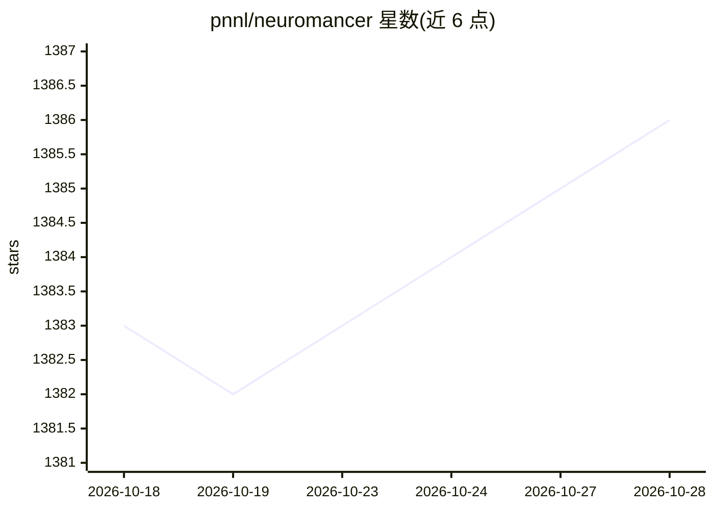

# pnnl/neuromancer

⭐ 1,386 · Python · NOASSERTION · 推送 2026-10-22 · [GitHub](https://github.com/pnnl/neuromancer) · [官网](https://pnnl.github.io/neuromancer/) · 组织维护

**PyTorch 可微编程库：求解参数化优化、系统辨识与预测控制**

由 PNNL 开发的开源可微编程库（NeuroMANCER），基于 PyTorch，面向参数化约束优化（L2O）、物理先验系统辨识（L2M）与参数化模型预测控制（L2C）。提供符号编程接口以嵌入物理方程与约束，涵盖 NODE、Deep Koopman、SINDy、KAN、Function Encoders、可微预测控制（DPC）与 PINNs 等方法；另提供脚本将库内容转换为 RAG 管线可摄取格式以构建 LLM 助手。通过 pip 安装，附带大量 Google Colab 教程与建筑能源等领域示例。

## 筛选速览

| 维度 | 判定 | 备注 |
|---|---|---|
| AI 角色 | `ai-native` | 本体是模型或模型工具 |
| 许可风险 | `none` | NOASSERTION |
| 部署形态 | `library` | 以包/库形式分发 |
| 模型依赖 | — | README 未给出锁定关系 |
| 硬件要求 | — | 无带数字的原话,不猜 |
| 安装摩擦 | `low` | 无编译、无系统依赖或容器化 |
| 成熟度 | — | 结构信号不足 |

## 能力要点

- 符号编程接口定义变量、约束、目标与系统
- Learning to Optimize / Model / Control 三类任务工具集
- 包含 NODE、Deep Koopman、SINDy、KAN、DPC、PINNs 等方法实现
- 提供转换脚本供 RAG 管线构建 NeuroMANCER-GPT 助手

## 适用场景

- 用神经网络学习求解参数化约束优化问题
- 对建筑热力学、电力等动力系统做物理先验的系统辨识
- 学习非线性系统的可微预测控制策略
- 求解扩散方程、Burgers 方程等 PINN 问题

## 场景标签

 · 领域:科学计算/控制与优化

## 证据(README 行号)

> L9: is an open-source differentiable programming (DP) library for solving parametric constrained optimization problems,
> L11: NeuroMANCER is written in PyTorch and allows for systematic
> L158: Neuromancer allows one to use machine learning, prior physics, and domain knowledge to construct data-driven model

## 星数曲线

2026-10-18 1,383 → 2026-10-28 1,386（+3）

---
*卡片 v1 · prompt 1.4 · 生成 2026-10-21 · 置信度 high · 依据 README sha `eecc47888594` · [字段定义](../../DATASET.md)*
