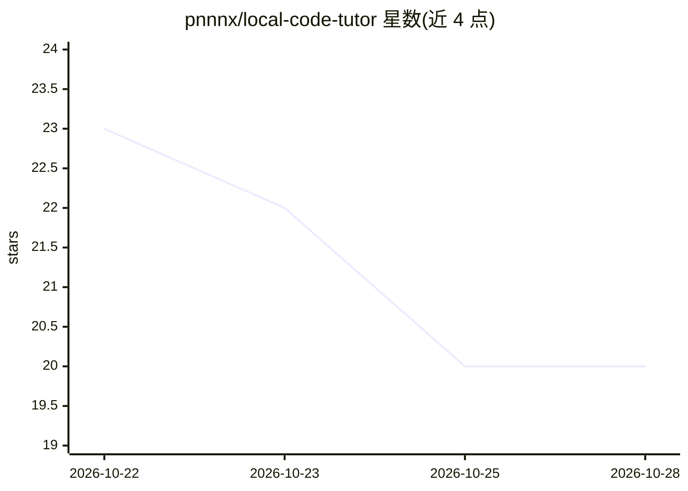

# pnnnx/local-code-tutor

⭐ 20 · Python · MIT · 推送 2026-10-21 · [GitHub](https://github.com/pnnnx/local-code-tutor) · [官网](https://github.com/pnnnx/loca) · 个人维护

**面向学生的本地代码辅导 agent：微调 Qwen2.5-Coder-7B 并实测运行代码**

该项目提供一套在 8 GB MacBook 上运行的本地代码教学方案：用免费 Kaggle T4 以 QLoRA 微调 Qwen2.5-Coder-7B，导出 GGUF Q4_K_M 后经 llama.cpp/Ollama 本地推理，由 stdlib-only 的 loca 终端 agent 调用。核心机制是『不猜测』——训练数据中每个代码片段都实际执行并校验输出，agent 在模型回答前先运行代码并将源码与真实输出放入上下文。另含 wtools 权重分析工具（CLI+MCP），可检查 LoRA 适配器的 ΔW、量化误差等并生成图表。含 1,581 条已验证训练样本与 18 题留出评测（13/18）。限制：明确不以大型重构或通用聊天为目标。

## 筛选速览

| 维度 | 判定 | 备注 |
|---|---|---|
| AI 角色 | `ai-native` | 本体是模型或模型工具 |
| 许可风险 | `permissive` | MIT |
| 部署形态 | `library` | 以包/库形式分发 |
| 模型依赖 | local-ok | 支持本地模型 |
| 硬件要求 | — | 无带数字的原话,不猜 |
| 安装摩擦 | `low` | 无编译、无系统依赖或容器化 |
| 成熟度 | `idea` | |

## 能力要点

- 训练数据中每个代码片段均实际执行，答案与真实输出不符即丢弃
- agent 在模型回答前先运行代码，源码+真实输出入上下文
- QLoRA 于免费 Kaggle T4 训练，GGUF Q4_K_M 在 MacBook Air M2 8 GB 完全离线运行
- wtools 权重分析工具（inspect/stats/diff/lora/quant，CLI+MCP）

## 适用场景

- 学生想在本地笔记本上获得解释代码行为的免费私人辅导
- 零成本复现 Qwen2.5-Coder-7B 的 QLoRA 微调与 GGUF 导出流程
- 分析 LoRA 适配器微调前后的权重变化与量化误差

## 场景标签

`微调` `模型量化` · 领域:训练与推理

## 证据(README 行号)

> L5: ### Fine-tune Qwen2.5-Coder-7B for free and run a coding agent that *runs your code instead of guessing* — on an 8 G
> L30: **Give every student a private, free code tutor that runs on their own laptop — and never states
> L104: confidently invent the output. This project is built around one rule:

## 星数曲线

2026-10-22 23 → 2026-10-28 20（-3）

---
*卡片 v1 · prompt 1.4 · 生成 2026-10-28 · 置信度 mid · 依据 README sha `d0cd8b9f01ad` · [字段定义](../../DATASET.md)*
