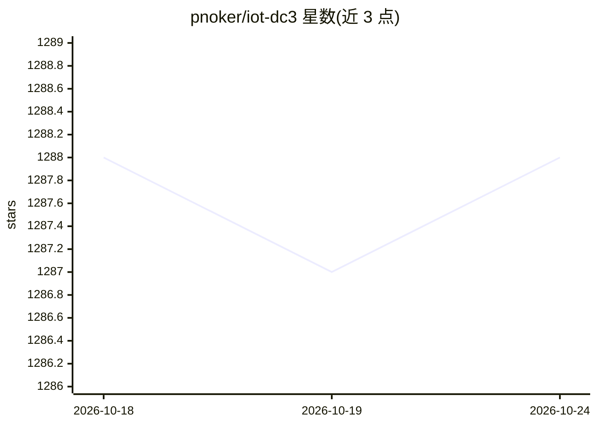

# pnoker/iot-dc3

⭐ 1,288 · Java · NOASSERTION · 推送 2026-10-22 · [GitHub](https://github.com/pnoker/iot-dc3) · [官网](https://dc3.site) · 个人维护 · 中文 README

**面向 Physical AI 的开源工业物联网运行时平台**

基于 Java 21 与 Spring Boot/Spring Cloud 的云原生工业物联网平台：提供 36 种协议驱动（Modbus、OPC UA、MQTT 等）采集设备数据，经消息总线与统一 API 交付给应用，实现设备与应用解耦。AI 部分包括基于 Spring AI 的 Agentic Center 与 MCP 工具网关，外部 AI agent 可在授权与审计下查询设备、读写点位、执行命令，兼容 OpenAI API 风格的 GPT、Claude、DeepSeek、Qwen 等模型。支持 Docker Compose/Kubernetes 部署，AGPL 3.0 许可并另提供商业许可。

## 筛选速览

| 维度 | 判定 | 备注 |
|---|---|---|
| AI 角色 | `ai-enhanced` | 去掉 AI 部分产品仍成立 |
| 许可风险 | `none` | NOASSERTION |
| 部署形态 | `self-host` | docker 或自建部署 |
| 模型依赖 | — | README 未给出锁定关系 |
| 硬件要求 | — | 无带数字的原话,不猜 |
| 安装摩擦 | `low` | 无编译、无系统依赖或容器化 |
| 成熟度 | — | 结构信号不足 |

## 能力要点

- 36 种协议驱动覆盖工业、IoT、数据桥接等场景，附 Driver SDK 开发自定义驱动
- MCP 工具网关：OAuth 注册、逐工具授权、全程审计，供 AI agent 操作物理设备
- 六层微服务架构，PostgreSQL（TimescaleDB+pgvector+AGE）持久化，可插拔消息中间件
- 租户隔离、JWT+RBAC、TLS 传输与审计日志

## 适用场景

- 工厂、水务、微电网等场景的设备接入与数据采集
- 让 AI agent 通过 MCP 在受控授权下查询和操作设备
- 用自然语言查询设备数据并生成可视化图表

## 场景标签

`数据分析` · 领域:效率与自动化

## 证据(README 行号)

> L24:  An open-source Industrial IoT Runtime for Physical AI
> L93: The Agentic Center is built on **Spring AI**, and the platform exposes an MCP tool gateway so AI agents can act on 
> L96: - **MCP tool gateway** — external AI agents connect through the Model Context Protocol: OAuth client registration,

## 星数曲线

2026-10-18 1,288 → 2026-10-24 1,288（+0）

---
*卡片 v1 · prompt 1.4 · 生成 2026-10-21 · 置信度 high · 依据 README sha `7f9900457930` · [字段定义](../../DATASET.md)*
