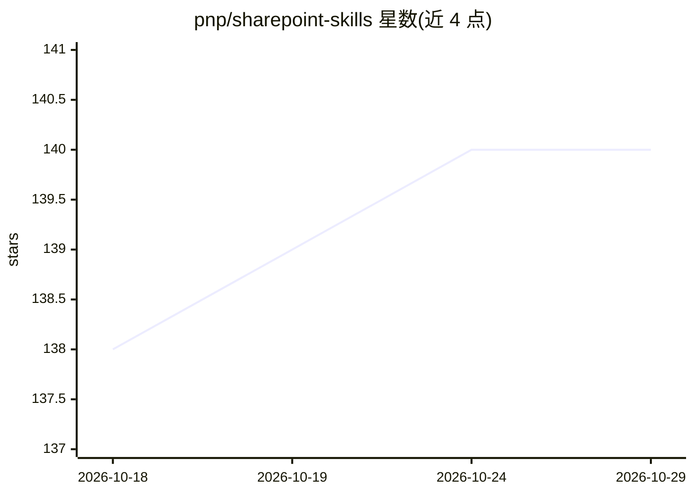

# pnp/sharepoint-skills

⭐ 140 · HTML · MIT · 推送 2026-10-27 · [GitHub](https://github.com/pnp/sharepoint-skills) · [官网](https://pnp.github.io/sharepoint-skills/) · 组织维护

**面向 SharePoint Copilot 的 AI 技能策展库，技能可直接安装**

由 pnp 维护的 SharePoint AI 技能库：Skills/ 目录下每个技能独立成文件夹，包含 SKILL.md，可上传至站点 Agent Assets 库的 Skills 文件夹安装，供 Copilot in SharePoint 执行聚焦、可复用的任务。使用前提是站点可用 Copilot in SharePoint、持有 Microsoft Copilot 许可证及相应站点权限（Edit 添加技能，View 运行技能）。声明非官方 Microsoft 文档，仅供学习与实验。

## 筛选速览

| 维度 | 判定 | 备注 |
|---|---|---|
| AI 角色 | `ai-knowledge` | 知识聚合/清单类 |
| 许可风险 | `permissive` | MIT |
| 部署形态 | `None` |  |
| 模型依赖 | — | README 未给出锁定关系 |
| 硬件要求 | — | 无带数字的原话,不猜 |
| 安装摩擦 | `low` | 无编译、无系统依赖或容器化 |
| 成熟度 | — | 结构信号不足 |

## 能力要点

- 每技能独立文件夹，含 SKILL.md，可直接安装到站点
- 通过 SharePoint Skills gallery 浏览与选择技能
- 安装后在 Copilot in SharePoint 中按自然语言或名称调用

## 适用场景

- 为站点 Copilot 添加聚焦任务的可复用技能
- 浏览技能库了解可用的 SharePoint AI 技能
- 按组织需求部署并规划 Copilot in SharePoint 的使用

## 场景标签

`精选清单` `提示工程` · 领域:Agent 开发

## 证据(README 行号)

> L5: A curated library of AI skills for the latest AI features in Microsoft 365 SharePoint.
> L17: - `Skills/`: AI skills — each skill in its own folder, ready to install into a SharePoint agent

## 星数曲线

2026-10-18 138 → 2026-10-29 140（+2）

---
*卡片 v1 · prompt 1.4 · 生成 2026-10-22 · 置信度 high · 依据 README sha `31079c3c243e` · [字段定义](../../DATASET.md)*
