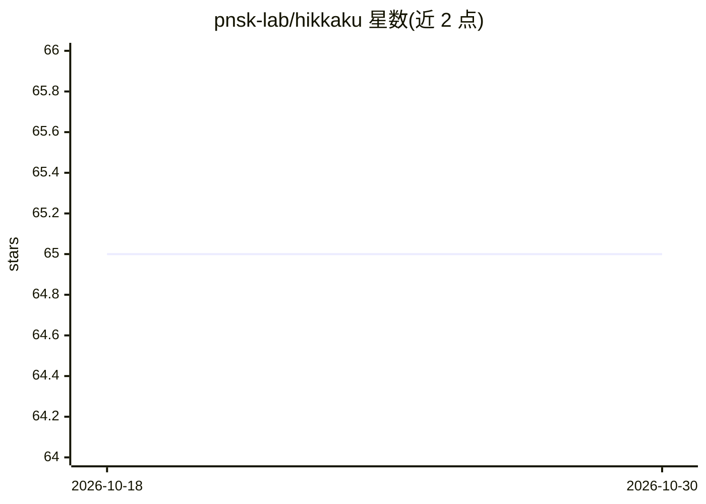

# pnsk-lab/hikkaku

⭐ 65 · TypeScript · MIT · 推送 2026-06-02 · [GitHub](https://github.com/pnsk-lab/hikkaku) · [官网](https://pnsk-lab.github.io/hikkaku/) · 组织维护

**用 TypeScript 生成 Scratch 项目的库，附 AI 编程技能包**

面向开发者的 TypeScript 库：以代码方式定义 Scratch 项目，运行后输出可载入 Scratch 编辑器的项目 JSON；提供 Vite 插件支持热重载开发与构建。官方脚手架 create-hikkaku 从模板生成新项目，可选生成 AGENTS.md/CLAUDE.md 与技能配置。另提供面向 AI Agent 的 skills 包，可配合 Codex、Claude Code、OpenCode 等工具进行自然语言编程。支持 bun/deno/pnpm/yarn/npm 多包管理器安装。

## 筛选速览

| 维度 | 判定 | 备注 |
|---|---|---|
| AI 角色 | `ai-enhanced` | 去掉 AI 部分产品仍成立 |
| 许可风险 | `permissive` | MIT |
| 部署形态 | `library` | 以包/库形式分发 |
| 模型依赖 | — | README 未给出锁定关系 |
| 硬件要求 | — | 无带数字的原话,不猜 |
| 安装摩擦 | `low` | 无编译、无系统依赖或容器化 |
| 成熟度 | — | 结构信号不足 |

## 能力要点

- TypeScript 代码生成可载入 Scratch 编辑器的项目 JSON
- Vite 插件支持热重载开发与项目构建
- create-hikkaku 官方脚手架从模板生成项目
- 提供 AI Agent skills 包，配合 Codex/Claude Code 等使用

## 适用场景

- 用 TypeScript 编写并构建 Scratch 项目
- 在 Vite 环境下热重载开发 Scratch 项目
- 让 AI 编程助手按技能规范生成 Scratch 代码

## 场景标签

`代码生成` · 领域:编码与开发

## 证据(README 行号)

> L9: Scratch with TypeScript.
> L58: By runnning this code, you will get a Scratch project JSON that you can load in Scratch editor.
> L92: Hikkaku has a skills for AI Agents, so you can vibe code with AI such as Codex, Claude Code, OpenCode and etc.

## 星数曲线

2026-10-18 65 → 2026-10-30 65（+0）

---
*卡片 v1 · prompt 1.4 · 生成 2026-10-24 · 置信度 high · 依据 README sha `cc3fdebd7a3b` · [字段定义](../../DATASET.md)*
