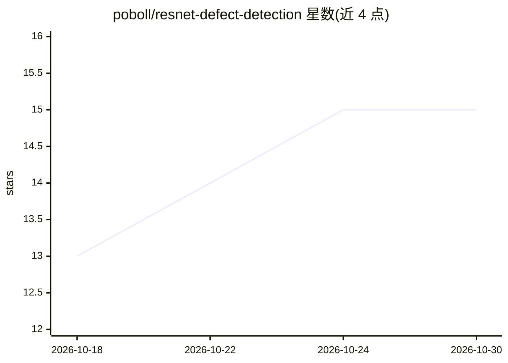

# poboll/resnet-defect-detection

⭐ 15 · HTML · MIT · 推送 2026-01-13 · [GitHub](https://github.com/poboll/resnet-defect-detection) · [官网](https://poboll.github.io/resnet-defect-detection/) · 个人维护 · 中文 README

**课程作业级 ResNet18 工业零件表面缺陷分类系统（6 类，98.33%）**

《人工智能应用技术》期末课程作业：以 ImageNet 预训练的 ResNet18 为基础，冻结前 8 层、自定义全连接层，通过迁移学习与数据增强对裂纹、夹杂、斑块、麻点、氧化皮、划痕 6 类表面缺陷做图像分类，验证集准确率 98.33%。提供训练脚本、Streamlit Web 演示（图片上传、置信度与概率分布展示）、训练曲线输出及 GitHub Actions 三平台打包流程。训练可在 CPU 上约 15 分钟完成，GPU 为可选项。

## 筛选速览

| 维度 | 判定 | 备注 |
|---|---|---|
| AI 角色 | `ai-native` | 本体是模型或模型工具 |
| 许可风险 | `permissive` | MIT |
| 部署形态 | `desktop` | 安装包/桌面程序 |
| 模型依赖 | — | README 未给出锁定关系 |
| 硬件要求 | — | 无带数字的原话,不猜 |
| 安装摩擦 | `low` | 无编译、无系统依赖或容器化 |
| 成熟度 | — | 结构信号不足 |

## 能力要点

- ImageNet 预训练 ResNet18 迁移学习，冻结前 8 层仅训练全连接层
- 6 类缺陷分类，验证集准确率 98.33%，各类别 F1 ≥ 0.95
- Streamlit Web 演示：上传图片实时检测，展示置信度与各类别概率分布
- 提供 train/run 启动脚本与 GitHub Actions 三平台可执行文件打包

## 适用场景

- 上传工业零件图片获得缺陷类别与置信度
- 作为迁移学习缺陷检测的课程教学示例
- 参考其打包流程生成免安装的桌面检测程序

## 场景标签

`目标检测` `教程课程` · 领域:学习与行业

## 证据(README 行号)

> L12: 本项目是《人工智能应用技术》期末课程作业，实现了一套基于 **ResNet18** 深度学习模型的工业零件表面缺陷智能检测系统。系统采用迁移学习策略，利用在 ImageNet 大规模数据集上预训练的 ResNet18 模型作为基础
> L16: - 🚀 **高精度检测**：验证集准确率达到 **98.33%**，各类别 F1 分数均不低于 0.95

## 星数曲线

2026-10-18 13 → 2026-10-30 15（+2）

---
*卡片 v1 · prompt 1.4 · 生成 2026-10-30 · 置信度 high · 依据 README sha `295cd0d32b3e` · [字段定义](../../DATASET.md)*
