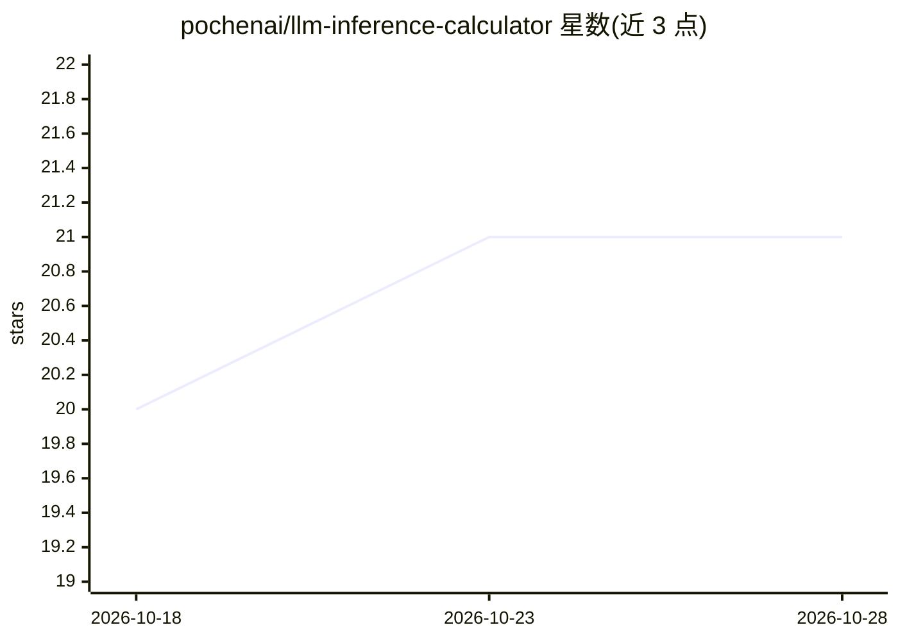

# pochenai/llm-inference-calculator

⭐ 21 · TypeScript · 推送 2026-10-06 · [GitHub](https://github.com/pochenai/llm-inference-calculator) · [官网](https://llm-inference-calculator-delta.vercel.app) · 个人维护 · 中文 README

**浏览器端 LLM 推理性能估算器：给模型/GPU/并行配置算显存与时延**

纯前端运行的 LLM 推理静态性能模型：输入模型、GPU、互联与工作负载，输出 VRAM 可行性、TTFT/TPOT/端到端时延与吞吐。内置 403 个模型与 110+ 款 NVIDIA GPU 库，采用两阶段 Roofline 模型（Prefill 算力受限、Decode 带宽受限），支持 TP/PP/EP/DP/PD 分离与自动并行布局求解，含投机解码与 5 种 KV cache 变体建模。默认输出理论峰值上界，可用效率常数校准。所有限制：不建模 continuous batching 与流水线气泡，量化假定为均匀精度。TypeScript 纯函数核心与 React UI 解耦，MIT 许可。

## 筛选速览

| 维度 | 判定 | 备注 |
|---|---|---|
| AI 角色 | `ai-ecosystem` | LLM/agent 周边工具 |
| 许可风险 | `permissive` | — |
| 部署形态 | `library` | 以包/库形式分发 |
| 模型依赖 | — | README 未给出锁定关系 |
| 硬件要求 | — | 无带数字的原话,不猜 |
| 安装摩擦 | `low` | 无编译、无系统依赖或容器化 |
| 成熟度 | — | 结构信号不足 |

## 能力要点

- 两阶段 Roofline 模型：Prefill→TTFT、Decode→TPOT/ITL，统一 VRAM/带宽/算力/通信四轴
- 内置 403 模型与 110+ NVIDIA GPU 库，5 种 KV cache 变体（MHA/MLA/线性注意力/SSM/滑动窗口）
- TP/PP/EP/DP/PD 分离统一建模，给定 GPU 数自动枚举并行布局并按 VRAM 可行性排序
- 全部计算在浏览器端运行，TypeScript 纯函数核心与 UI 解耦

## 适用场景

- 部署前估算某模型在指定 GPU 配置下的显存可行性与时延/吞吐
- 对比不同并行策略（TP/PP/EP/PD 分离）下的性能理论值
- 通过可分享 URL 与他人同步性能测算场景

## 场景标签

 · 领域:LLM 基础设施/性能建模

## 证据(README 行号)

> L3: **A static performance model for LLM inference: given (model, GPU, interconnect, workload), instantly answer VRAM fe
> L37: **Runs entirely in the browser, zero backend cost:**

## 星数曲线

2026-10-18 20 → 2026-10-28 21（+1）

---
*卡片 v1 · prompt 1.4 · 生成 2026-10-28 · 置信度 high · 依据 README sha `dc48c6d84fcf` · [字段定义](../../DATASET.md)*
