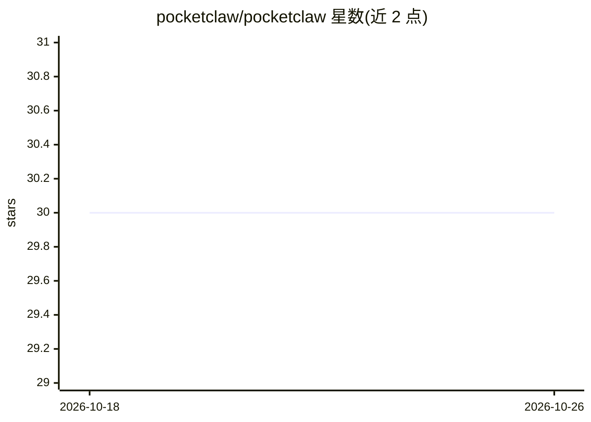

# pocketclaw/pocketclaw

⭐ 30 · Shell · MIT · 推送 2026-02-20 · [GitHub](https://github.com/pocketclaw/pocketclaw) · [官网](https://pocketclaw.dev) · 个人维护

**把2015年旧安卓手机改造成7x24自托管AI助手**

基于 OpenClaw 网关在低端安卓手机（如1GB内存的Moto E2、Android 5+）上部署自托管 AI 助手的项目：通过 Telegram 对话获取任意 OpenAI 兼容 LLM 的回答，支持语音消息转文字（OpenAI Whisper）。配备4页 Web 仪表盘（状态/日志/密钥/控制）、CLI、watchdog 自动重启与开机自启。运行依赖大量已记录的内存与系统优化手段（原生 node22、Dalvik 清理、懒加载、debloat、Dirty COW 等，共57条 hack）。设置需 PC 端 ADB 与 USB 调试。

## 筛选速览

| 维度 | 判定 | 备注 |
|---|---|---|
| AI 角色 | `ai-native` | 本体是模型或模型工具 |
| 许可风险 | `permissive` | MIT |
| 部署形态 | `desktop` | 安装包/桌面程序 |
| 模型依赖 | local-ok | 支持本地模型 |
| 硬件要求 | — | 无带数字的原话,不猜 |
| 安装摩擦 | `low` | 无编译、无系统依赖或容器化 |
| 成熟度 | — | 结构信号不足 |

## 能力要点

- 在1GB内存/ARM32/Android 6 的手机上运行 OpenClaw 网关（总占用约310MB）
- Telegram 机器人7x24应答，兼容任意 OpenAI 兼容提供商，语音消息经 Whisper 转文字
- 4页 Web 仪表盘（STATUS/LOGS/KEYS/CTRL）与 pocketclaw CLI
- watchdog + 健康检查自动重启，重启后自动恢复运行

## 适用场景

- 把抽屉里的旧安卓手机变成自托管 AI 助手
- 通过 Telegram 随时与自选 LLM 对话，无需云服务器
- 低配 ARM32 设备上跑 Node.js AI 网关的优化参考

## 场景标签

 · 领域:自托管 AI 助手/移动端部署

## 证据(README 行号)

> L42: We turned it into a **self-hosted AI assistant** that runs 24/7, answers on Telegram, and survives reboots on its o
> L55: - **A Telegram bot** running 24/7 on a phone that belongs in a museum
> L57: - **Voice messages** — send a voice note, get a text reply (via OpenAI Whisper)

## 星数曲线

2026-10-18 30 → 2026-10-26 30（+0）

---
*卡片 v1 · prompt 1.4 · 生成 2026-10-26 · 置信度 high · 依据 README sha `ec10d37be734` · [字段定义](../../DATASET.md)*
