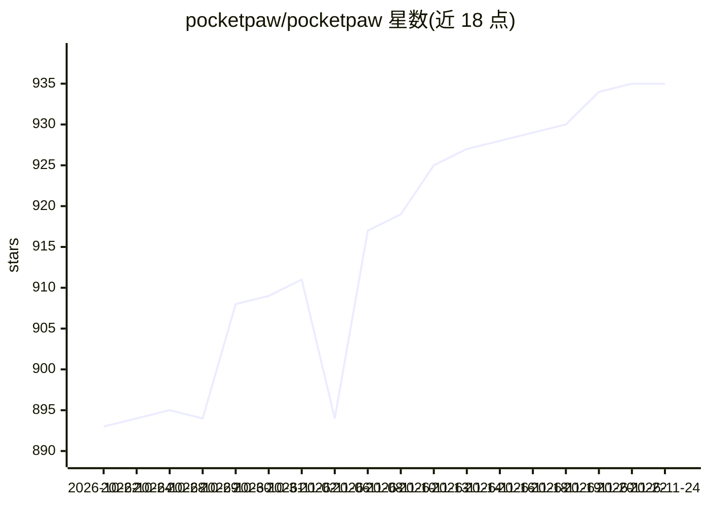

# pocketpaw/pocketpaw

⭐ 937 · Python · MIT · 推送 2026-11-22 · [GitHub](https://github.com/pocketpaw/pocketpaw) · [官网](http://pocketpaw.xyz/) · 组织维护

**自托管个人 AI agent：桌面应用+多渠道对话+7 层安全**

本机运行的开源 AI agent，通过 Web 仪表盘与原生桌面应用（Tauri 2.0 + SvelteKit）交付，可经 Discord、Slack、WhatsApp、Telegram、Signal 等 9+ 渠道对话。采用事件驱动消息总线，6 种 Agent 后端（Claude Agent SDK、OpenAI Agents、Google ADK、Codex CLI、OpenCode、Copilot SDK）实现同一 AgentBackend 协议可互换；内置 50+ 工具（浏览器、图像生成、语音、OCR）、长期记忆（Mem0）与 7 层安全栈（Guardian AI 审查每次工具调用、注入扫描、计划模式、审计日志）。安装需 Python 3.11+，处于 Beta 阶段，版本间可能有破坏性变更。

## 筛选速览

| 维度 | 判定 | 备注 |
|---|---|---|
| AI 角色 | `ai-native` | 本体是模型或模型工具 |
| 许可风险 | `permissive` | MIT |
| 部署形态 | `desktop` | 安装包/桌面程序 |
| 模型依赖 | local-ok | 支持本地模型 |
| 硬件要求 | — | 无带数字的原话,不猜 |
| 安装摩擦 | `low` | 无编译、无系统依赖或容器化 |
| 成熟度 | `idea` | |

## 能力要点

- 6 种可互换的 Agent 后端，统一 AgentBackend 协议
- 7 层安全栈：Guardian AI 审查工具调用、注入扫描、计划模式、审计日志
- 9+ 消息渠道（Discord/Slack/WhatsApp/Telegram/Signal/Matrix 等）
- 支持 Ollama 实现完全本地离线运行

## 适用场景

- 在本地部署一个可通过 Telegram/Discord 随时对话的个人助手
- 给 agent 配置定时提醒与 Gmail/Calendar/Drive 集成
- 需要工具调用安全审计与人工审批的自托管 agent

## 场景标签

`AI 助手` · 领域:对话与助手

## 证据(README 行号)

> L17:  Self-hosted AI agent with a native desktop app and web dashboard. Talks to you over Discord , Slack , WhatsApp , T
> L210: |🧠 **6 Agent Backends**|Claude Agent SDK, OpenAI Agents, Google ADK, Codex CLI, OpenCode, Copilot SDK|
> L238: |**Claude Agent SDK** (Default)|`claude_agent_sdk`|Anthropic, Ollama|Yes|

## 星数曲线

2026-10-22 893 → 2026-11-24 935（+42）

---
*卡片 v1 · prompt 1.4 · 生成 2026-11-24 · 置信度 high · 依据 README sha `7d360019f49a` · [字段定义](../../DATASET.md)*
