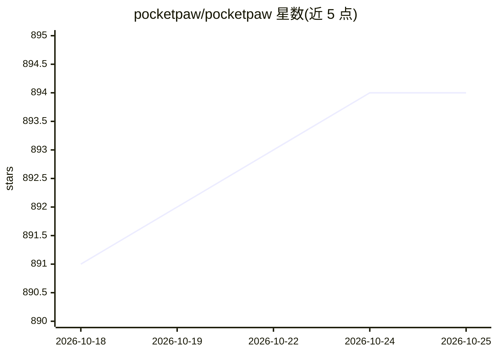

# pocketpaw/pocketpaw

⭐ 894 · Python · MIT · 推送 2026-10-25 · [GitHub](https://github.com/pocketpaw/pocketpaw) · [官网](http://pocketpaw.xyz/) · 组织维护

**自托管个人 AI agent，多渠道对话+桌面应用，本地运行**

运行在用户自己机器上的个人 AI agent：Python 后端加 Tauri 2.0 + SvelteKit 原生桌面客户端与 Web 仪表盘，通过 Discord、Slack、WhatsApp、Telegram 等 9+ 渠道对话。支持 6 种 agent 后端（默认 Claude Agent SDK），可接 Anthropic、OpenAI、Google API key 或用 Ollama 做本地推理。内含 50+ 工具（浏览器、搜索、语音等）与 7 层安全机制（Guardian AI 审查每次工具调用、注入扫描、审计日志）。项目声明处于 Beta，版本间可能有破坏性变更。

## 筛选速览

| 维度 | 判定 | 备注 |
|---|---|---|
| AI 角色 | `ai-native` | 本体是模型或模型工具 |
| 许可风险 | `permissive` | MIT |
| 部署形态 | `desktop` | 安装包/桌面程序 |
| 模型依赖 | local-ok | 支持本地模型 |
| 硬件要求 | — | 无带数字的原话,不猜 |
| 安装摩擦 | `low` | 无编译、无系统依赖或容器化 |
| 成熟度 | `idea` | |

## 能力要点

- 9+ 对话渠道与 6 种可切换的 agent 后端（同一 AgentBackend 协议）
- Guardian AI 二级 LLM 审查每次工具调用，附注入扫描与审计日志
- 支持 Ollama 完全离线运行，API key 静态加密存储
- 提供 Windows/macOS/Linux 桌面安装包与 pipx/uv/Docker 安装方式

## 适用场景

- 在自己机器上运行个人 AI 助手，通过 Discord/Telegram 等聊天工具交互
- 定时任务与日程提醒（如每周日提醒垃圾分类）
- 通过 Ollama 做完全离线的本地 AI 操作

## 场景标签

`AI 助手` · 领域:对话与助手

## 证据(README 行号)

> L17:  Self-hosted AI agent with a native desktop app and web dashboard. Talks to you over Discord , Slack , WhatsApp , T
> L210: |🧠 **6 Agent Backends**|Claude Agent SDK, OpenAI Agents, Google ADK, Codex CLI, OpenCode, Copilot SDK|
> L211: |🛠️ **50+ Tools**|Browser, web search, image gen, voice/TTS/STT, OCR, research, delegation, skills|

## 星数曲线

2026-10-18 891 → 2026-10-25 894（+3）

---
*卡片 v1 · prompt 1.4 · 生成 2026-10-21 · 置信度 high · 依据 README sha `6d2e7fcdb82e` · [字段定义](../../DATASET.md)*
