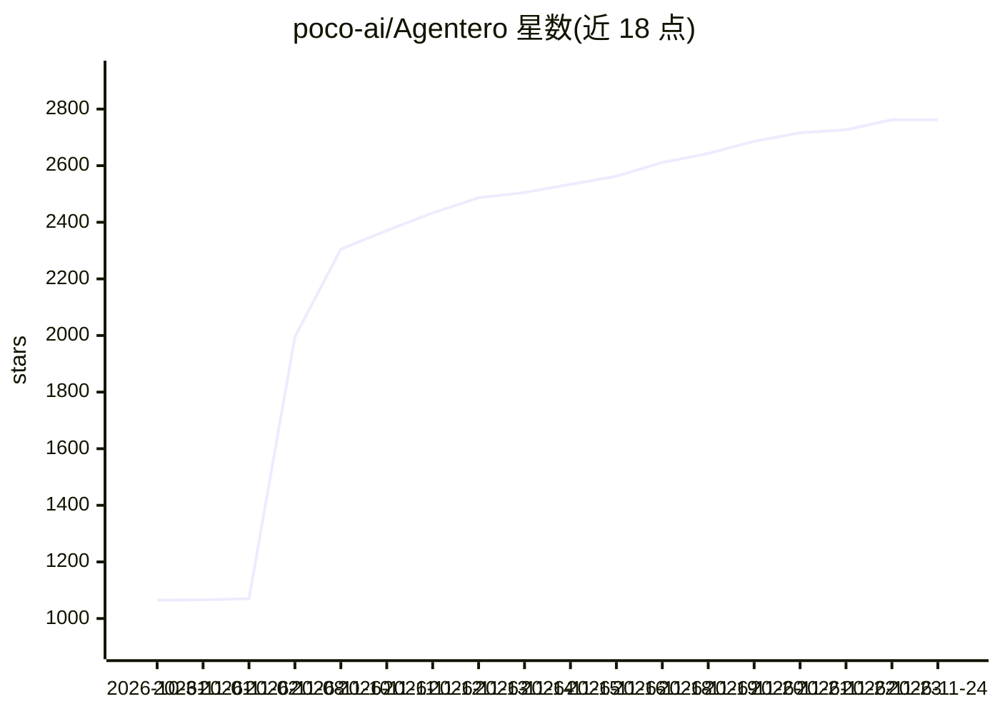

# poco-ai/Agentero

⭐ 2,762 · TypeScript · MIT · 推送 2026-11-22 · [GitHub](https://github.com/poco-ai/Agentero) · [官网](https://agentero.app) · 组织维护 · 中文 README

**与 Agent 协同读论文的本地科研工作台，含 PDF 问答与笔记**

面向科研人员与 AI Agent 协作的文献工作台：本地保存论文、笔记与对话，读 PDF 时可将选中原文、图表或批注发给 Agent 分析。通过 ACP 协议连接本机 Agent（如 Claude Code），内置 MCP 服务让 ChatGPT Web、Claude Desktop 等客户端查询文献库。提供结构化 PDF 解析（公式/表格转 Markdown/LaTeX）、双链笔记、学术雷达（Cool Papers/arXiv Daily）、Zotero 迁移、S3 同步与 CLI 批量处理。桌面端覆盖 macOS/Windows/Linux。

## 筛选速览

| 维度 | 判定 | 备注 |
|---|---|---|
| AI 角色 | `ai-enhanced` | 去掉 AI 部分产品仍成立 |
| 许可风险 | `permissive` | MIT |
| 部署形态 | `None` |  |
| 模型依赖 | — | README 未给出锁定关系 |
| 硬件要求 | — | 无带数字的原话,不猜 |
| 安装摩擦 | `low` | 无编译、无系统依赖或容器化 |
| 成熟度 | — | 结构信号不足 |

## 能力要点

- 通过 ACP 连接 Claude Code、OpenCode、Codex 等本机 Agent 伴读 PDF
- 内置 MCP 服务，外部客户端可查询本地文献库
- 公式、伪代码、表格解析为 Markdown/LaTeX 供 Agent 读取
- 兼容 Zotero 生态，支持迁移导入与 BibTeX 导出

## 适用场景

- 读论文时把选中段落和图发给 Agent 一起分析
- 把分散在 Zotero、Obsidian、网页对话里的资料集中到一个工作台
- 通过 MCP 让其他 AI 客户端检索自己的文献库
- 批量导入新论文并自动补齐元数据

## 场景标签

`科研工具` `知识库管理` `文档问答` · 领域:知识与检索

## 证据(README 行号)

> L3:  用来找论文、做笔记和跟 Agent 一起读文献的科研工作台
> L52: * **用 ACP 连接 Agent。** 通过 Agent Client Protocol 使用本机上的 Claude Code、OpenCode、Codex 等 Agent，也可以用支持本地模型的 Agent。发送消息时，问题
> L53: * **通过 MCP 访问文献库。** 开启内置的 Model Context Protocol 服务后，可以让 ChatGPT Web、Claude Desktop 等支持 MCP 的客户端查询知识库。不同客户端有各自的连接方式

## 星数曲线

2026-10-31 1,065 → 2026-11-24 2,762（+1,697）

---
*卡片 v1 · prompt 1.4 · 生成 2026-11-23 · 置信度 high · 依据 README sha `e22f56126389` · [字段定义](../../DATASET.md)*
