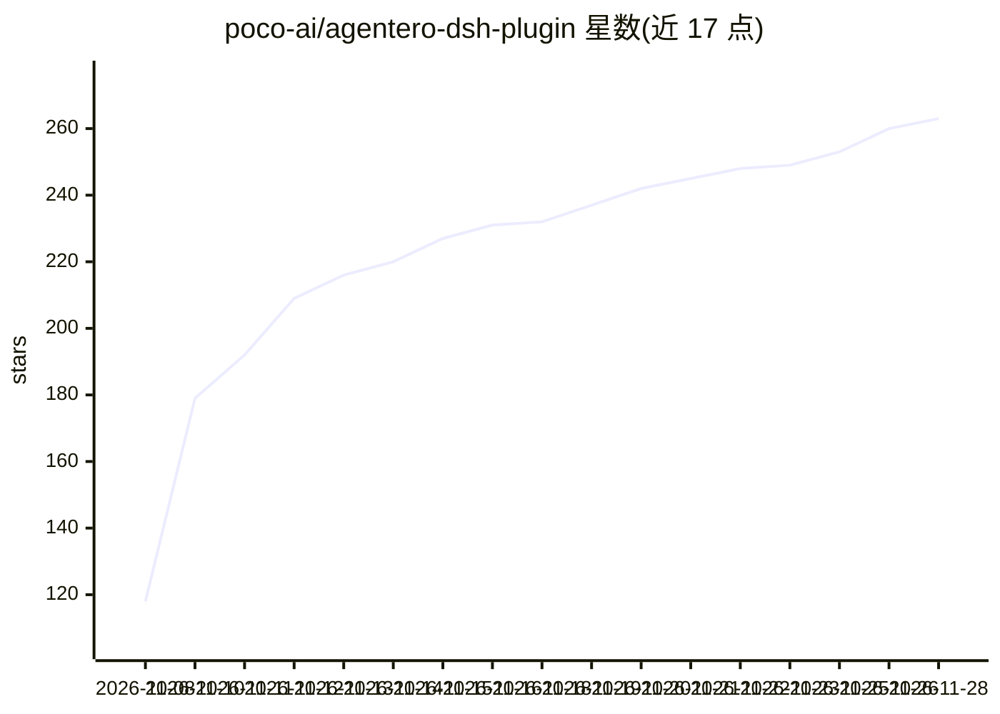

# poco-ai/agentero-dsh-plugin

⭐ 263 · TypeScript · 推送 2026-11-24 · [GitHub](https://github.com/poco-ai/agentero-dsh-plugin) · [官网](https://agentero.app) · 组织维护 · 中文 README

**给 DeepSeek Harness 用的本地科研文献库插件**

Agentero 的 dsh 插件，把文献库、笔记和 PDF 阅读器带入 DeepSeek Harness 工作台：用户在中间聊天窗口与 Agent 讨论，右侧阅读论文，Agent 可搜索已有文献与笔记并引用真实本地论文作答、按 arXiv/DOI/链接导入新论文、代写整理笔记，还支持基于 dsh 配置的 DeepSeek 模型在原页面上逐段全文翻译并保留公式版面。数据存于本地 Vault（papers/notes/sqlite 目录结构），与 Agentero 桌面端共用；扫描件 OCR 需在桌面端完成。

## 筛选速览

| 维度 | 判定 | 备注 |
|---|---|---|
| AI 角色 | `ai-enhanced` | 去掉 AI 部分产品仍成立 |
| 许可风险 | `none` | — |
| 部署形态 | `None` |  |
| 模型依赖 | — | README 未给出锁定关系 |
| 硬件要求 | — | 无带数字的原话,不猜 |
| 安装摩擦 | `low` | 无编译、无系统依赖或容器化 |
| 成熟度 | — | 结构信号不足 |

## 能力要点

- Agent 可检索本地文献与笔记，回答引用真实本地论文
- 按 arXiv、DOI 或链接自动导入论文并整理
- 基于 dsh 配置的 DeepSeek 模型逐段全文翻译，保留公式与版面
- PDF 划词可复制、高亮、批注、翻译或加入对话

## 适用场景

- 边读论文边和 Agent 讨论并让引用自己文献库
- 让 Agent 找出某方向近两年论文导入并整理提纲
- 把讨论整理成带出处的阅读笔记

## 场景标签

`知识库管理` `科研工具` `文档问答` · 领域:知识与检索

## 证据(README 行号)

> L3: Agentero 是本地优先的科研工作台。这个插件把它的文献库、笔记和 PDF 阅读器带进 DeepSeek Harness（下称 dsh），让 Agent 和你坐在同一个窗口里做科研：你读论文、做判断，Agent 帮你查资料、翻笔
> L26: - **全文翻译**：用 dsh 配置的 DeepSeek 模型在原页面上逐段替换，保留公式和版面。

## 星数曲线

2026-11-08 118 → 2026-11-28 263（+145）

---
*卡片 v1 · prompt 1.4 · 生成 2026-11-25 · 置信度 high · 依据 README sha `3f3fdea524ef` · [字段定义](../../DATASET.md)*
