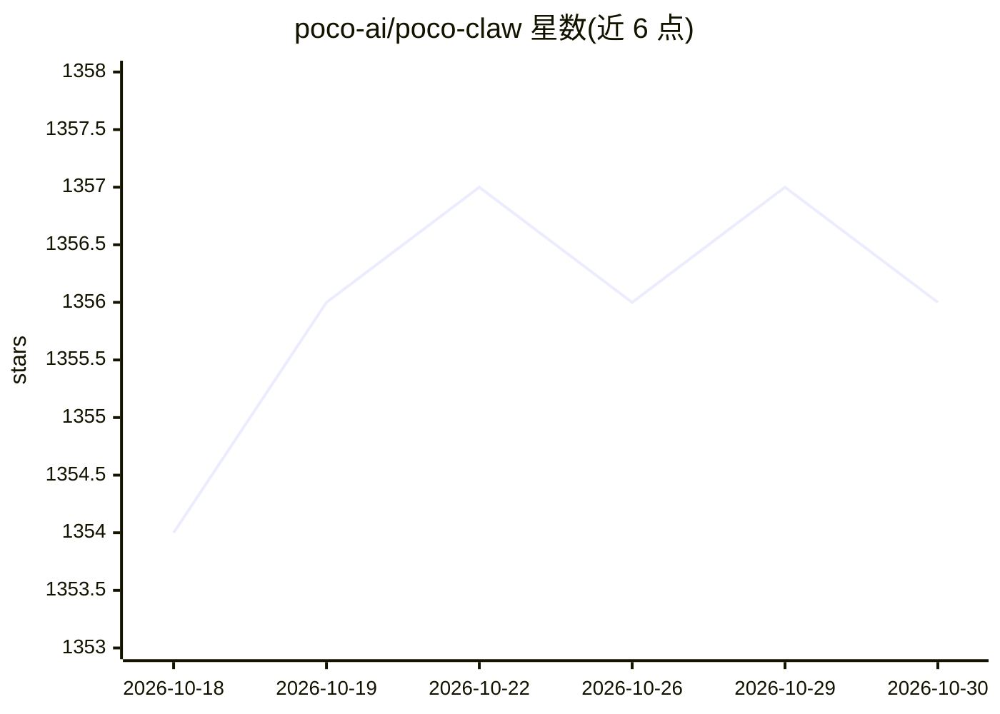

# poco-ai/poco-claw

⭐ 1,356 · Python · MIT · 推送 2026-10-19 · [GitHub](https://github.com/poco-ai/poco-claw) · [官网](https://poco-docs.vercel.app/) · 组织维护 · 中文 README

**面向团队协作的自托管 AI agent 应用，OpenClaw 替代品**

基于 Claude Code agent 的自托管 AI 协作工具，自称 OpenClaw 替代品：提供服务器与频道式的长期协作，可在对话中 @ 持久化 agent、将消息转为任务并跟踪执行进度。所有任务运行在隔离容器沙箱中，支持挂载本地目录、项目级预设配置、MCP 与 Skills 导入、内置浏览器、IM 集成（钉钉/飞书/Telegram）及移动端访问；记忆层由 mem0 提供。通过 quickstart 脚本一键启动，云端订阅标注 coming soon。

## 筛选速览

| 维度 | 判定 | 备注 |
|---|---|---|
| AI 角色 | `ai-native` | 本体是模型或模型工具 |
| 许可风险 | `permissive` | MIT |
| 部署形态 | `None` |  |
| 模型依赖 | — | README 未给出锁定关系 |
| 硬件要求 | — | 无带数字的原话,不猜 |
| 安装摩擦 | `low` | 无编译、无系统依赖或容器化 |
| 成熟度 | — | 结构信号不足 |

## 能力要点

- 服务器/频道式协作，agent 执行进度可在 drawer 中跟踪
- 任务运行于隔离容器沙箱，支持本地目录挂载（自托管）
- MCP 与 Skills 导入、内置浏览器、GitHub 仓库集成
- IM 集成（DingTalk/Feishu/Telegram）与移动端支持

## 适用场景

- 在团队频道里让持久化 agent 接收任务并跟踪进度
- 自托管一个带沙箱隔离与项目管理的 AI 协作工作台
- 通过钉钉/飞书/Telegram 或手机随时操控 agent

## 场景标签

`编码 Agent` `AI 助手` · 领域:编码与开发

## 证据(README 行号)

> L5: A safer, more beautiful, and easier-to-use OpenClaw alternative
> L38:  - **native Claude Code experience** - Slash Commands, Plan Mode, AskQuestion ...
> L52:  Powered by **mem0**: the agent remembers your preferences, project context, and past interactions to deliver incre

## 星数曲线

2026-10-18 1,354 → 2026-10-30 1,356（+2）

---
*卡片 v1 · prompt 1.4 · 生成 2026-10-21 · 置信度 high · 依据 README sha `b89902bb8129` · [字段定义](../../DATASET.md)*
