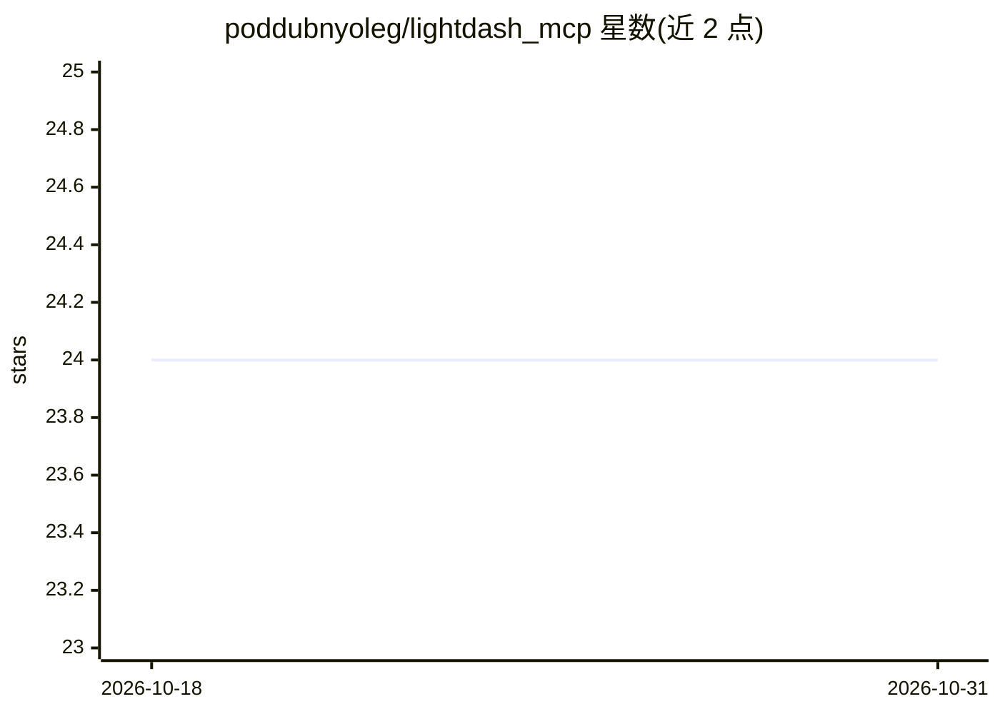

# poddubnyoleg/lightdash_mcp

⭐ 24 · Python · MIT · 推送 2026-07-01 · [GitHub](https://github.com/poddubnyoleg/lightdash_mcp) · [官网](https://pypi.org/project/lightdash-mcp/) · 个人维护

**连接 AI 助手与 Lightdash 分析平台的 MCP 服务器**

基于 Model Context Protocol 的服务器，使 Claude、Cursor 等 AI 助手能够操作 Lightdash 分析实例：浏览数据目录与表结构、执行带过滤与聚合的查询、创建/更新/删除图表与仪表盘、管理空间组织内容。通过 Lightdash Personal Access Token 认证，支持 Cloud 版与自托管实例，可选支持 Cloudflare Access 与 Google Cloud IAP 认证。以 Python 包发布于 PyPI，可用 pip/uvx/pipx 安装，需 Python 3.10+。

## 筛选速览

| 维度 | 判定 | 备注 |
|---|---|---|
| AI 角色 | `ai-ecosystem` | LLM/agent 周边工具 |
| 许可风险 | `permissive` | MIT |
| 部署形态 | `library` | 以包/库形式分发 |
| 模型依赖 | — | README 未给出锁定关系 |
| 硬件要求 | — | 无带数字的原话,不猜 |
| 安装摩擦 | `low` | 无编译、无系统依赖或容器化 |
| 成熟度 | — | 结构信号不足 |

## 能力要点

- 提供发现、查询、图表、仪表盘、空间五类共 30 余个 MCP 工具
- 支持并发执行仪表盘全部 tiles 的查询
- 可选 Google Cloud IAP 认证（JWT 签名，服务账号与 ADC 均支持）
- 工具从 tools/ 目录自动发现注册，便于扩展

## 适用场景

- 让 Claude Desktop/Cursor 直接查询并生成 Lightdash 图表
- 通过对话管理 Lightdash 仪表盘与空间
- 对自托管或 IAP 后的 Lightdash 实例做 AI 接入

## 场景标签

`数据分析` · 领域:效率与自动化

## 证据(README 行号)

> L9: > Connect Claude, Cursor, and other AI assistants to your Lightdash analytics using the Model Context Protocol (MCP)
> L11: A Model Context Protocol (MCP) server for interacting with Lightdash, enabling LLMs to discover data, create charts
> L15: This MCP server provides a comprehensive set of tools for the full data analytics workflow:

## 星数曲线

2026-10-18 24 → 2026-10-31 24（+0）

---
*卡片 v1 · prompt 1.4 · 生成 2026-10-27 · 置信度 high · 依据 README sha `c6e974b1df09` · [字段定义](../../DATASET.md)*
