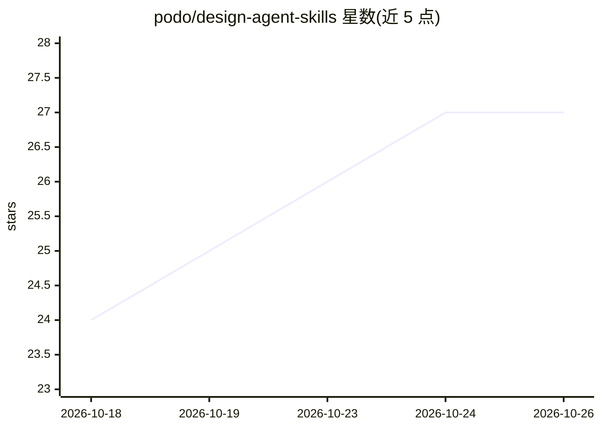

# podo/design-agent-skills

⭐ 27 · JavaScript · MIT · 推送 2026-10-21 · [GitHub](https://github.com/podo/design-agent-skills) · [官网](https://www.npmjs.com/package/design-agent-skills) · 个人维护

**面向 AI 编程 agent 的设计技能策展目录（160 条，两层路由）**

收录 160 个设计类 agent 技能的轻量索引目录，覆盖 UI 工艺、动效、Figma 工作流、无障碍、数据可视化、演示、PM 工具、内容设计与用户研究等 18 个类别，兼容 Claude Code、Cursor、Codex、OpenCode 等 30+ 编程 agent。机制上分两层：本仓库永久维护 6 个领域路由目录，154 个实现技能以指针形式按需安装（npx skills add 拉取上游）；一次安装通过符号链接同步到所有 agent 目录。技能按官方/社区/实验三档分类，实验档默认排除；上游无版本化发布，需 skills update 保持更新。

## 筛选速览

| 维度 | 判定 | 备注 |
|---|---|---|
| AI 角色 | `ai-knowledge` | 知识聚合/清单类 |
| 许可风险 | `permissive` | MIT |
| 部署形态 | `library` | 以包/库形式分发 |
| 模型依赖 | — | README 未给出锁定关系 |
| 硬件要求 | — | 无带数字的原话,不猜 |
| 安装摩擦 | `low` | 无编译、无系统依赖或容器化 |
| 成熟度 | — | 结构信号不足 |

## 能力要点

- 160 个设计技能按 18 个类别组织，按需安装而非批量下载
- 两层结构：6 个本仓库路由 + 154 个上游实现指针
- 一次安装经符号链接同步至 30+ 个 agent 目录
- 三档来源分类（official 34/community 72/experimental 60），实验档默认排除

## 适用场景

- 为 Claude Code/Cursor/Codex 等 agent 按需添加设计领域技能
- 按类别（动效、无障碍、Figma 转代码等）查找设计技能
- 用 --picks 配置文件快速获得各类别精选技能

## 场景标签

`精选清单` · 领域:学习与行业

## 证据(README 行号)

> L3: A curated catalogue of design skills for Claude Code, Cursor, Codex, OpenCode, and 30+ other AI coding agents.
> L4: 160 skills covering UI craft, motion, Figma workflows, accessibility, data viz, presentations, PM tools, content des

## 星数曲线

2026-10-18 24 → 2026-10-26 27（+3）

---
*卡片 v1 · prompt 1.4 · 生成 2026-10-26 · 置信度 high · 依据 README sha `04d731124adb` · [字段定义](../../DATASET.md)*
