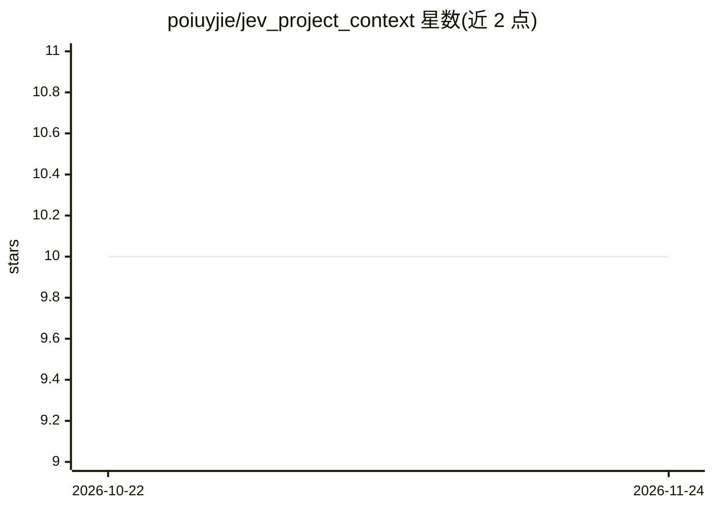

# poiuyjie/jev_project_context

⭐ 10 · Python · MIT · 推送 2026-09-22 · [GitHub](https://github.com/poiuyjie/jev_project_context) · 个人维护 · 中文 README

**为 AI 编码 agent 提供证据可追溯的长期实验记忆**

一个面向 AI 编码 agent（Claude Code、ZCode 等兼容 skills 的 agent）的技能包，把 agent 变成遵守规范的实验记录管理员：提供 10 个操作（init/frame/plan/record/claim-audit/doctor 等）、受控效度词汇、来源追踪门与只读审计，使每条结论可从问题追溯到证据，会话可恢复。可选配置 TYPESAFE_API_KEY 后启用 Jev 决策模型层，做上下文分诊与语义预筛；无 key 时回退到 agent 主模型执行相同检查。脚本仅需 Python ≥3.10，零第三方依赖，MIT 许可。

## 筛选速览

| 维度 | 判定 | 备注 |
|---|---|---|
| AI 角色 | `ai-ecosystem` | LLM/agent 周边工具 |
| 许可风险 | `permissive` | MIT |
| 部署形态 | `library` | 以包/库形式分发 |
| 模型依赖 | — | README 未给出锁定关系 |
| 硬件要求 | — | 无带数字的原话,不猜 |
| 安装摩擦 | `low` | 无编译、无系统依赖或容器化 |
| 成熟度 | — | 结构信号不足 |

## 能力要点

- 10 个操作的实验记忆工作流：假设登记、冻结协议、来源门、只读审计
- 可选 Jev 决策模型层：单次批量调用输出带置信度的预筛结果
- 无 API key 或调用失败时完整回退到 agent 主模型
- 失效结果保留可见，通过 supersedes/superseded_by 双向链接追踪

## 适用场景

- 用 Claude Code 管理研究项目的实验记录与上下文恢复
- 对记录中的声明与证据做支持性分类审计
- 防止实验配置、基线依据等关键上下文随时间丢失

## 场景标签

`Agent 记忆` · 领域:Agent 开发

## 证据(README 行号)

> L5: Evidence-first, long-term experiment memory for AI coding agents. Every claim stays traceable from question to evide
> L7: Research projects rarely die because results are lost — they die because their *context* is: which config produced t
> L57: npx skills add poiuyjie/jev_project_context

## 星数曲线

2026-10-22 10 → 2026-11-24 10（+0）

---
*卡片 v1 · prompt 1.4 · 生成 2026-11-19 · 置信度 high · 依据 README sha `d3e50a496f1f` · [字段定义](../../DATASET.md)*
