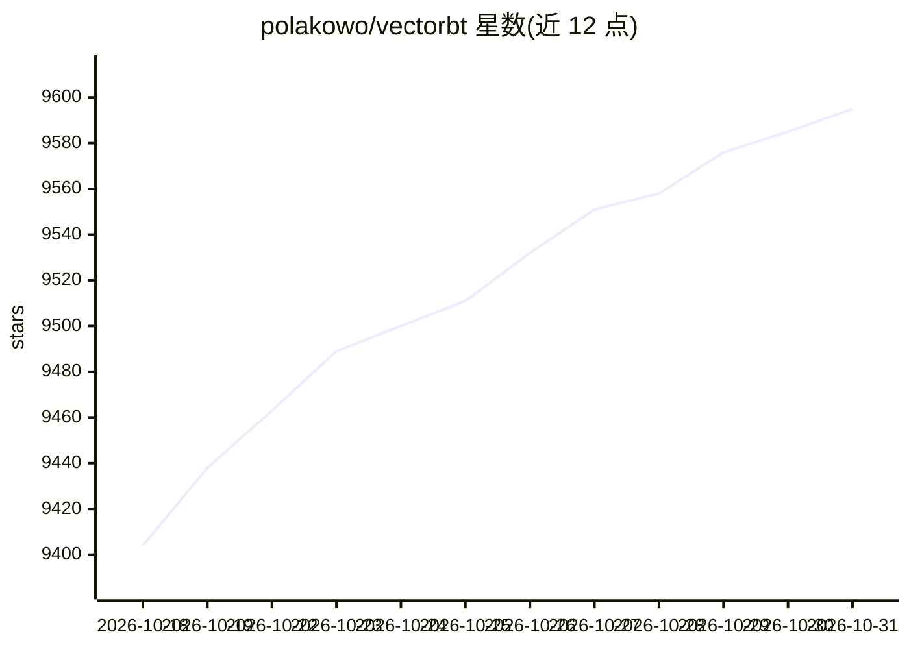

# polakowo/vectorbt

⭐ 9,595 · Python · NOASSERTION · 推送 2026-10-28 · [GitHub](https://github.com/polakowo/vectorbt) · [官网](https://vectorbt.dev) · 个人维护 · 中文 README

**面向量化研究的向量化回测引擎：批量测试数千策略组合**

Python 量化回测库：将数千个策略配置打包进 NumPy 数组，用 Numba 加速与可选 Rust 预编译内核并行执行，把网格搜索从小时级缩短到秒级。提供 pandas 原生 API、指标生态（TA-Lib/Pandas TA 集成）、组合与交易分析、信号工具、内置数据获取、walk-forward 优化与 Plotly 交互可视化。面向量化研究员，也支持 AI agent 驱动的工作流与机器学习标签生成。为闭源 VectorBT PRO 的开源社区版，采用 Apache 2.0 with Commons Clause（fair-code）许可，仅供教育用途。

## 筛选速览

| 维度 | 判定 | 备注 |
|---|---|---|
| AI 角色 | `ai-enhanced` | 去掉 AI 部分产品仍成立 |
| 许可风险 | `none` | NOASSERTION |
| 部署形态 | `self-host` | docker 或自建部署 |
| 模型依赖 | — | README 未给出锁定关系 |
| 硬件要求 | — | 无带数字的原话,不猜 |
| 安装摩擦 | `low` | 无编译、无系统依赖或容器化 |
| 成熟度 | — | 结构信号不足 |

## 能力要点

- 向量化批量回测：Numba 加速 + 可选 Rust 预编译内核
- 灵活广播机制，跨资产、跨参数网格大规模扫描
- 内置数据获取、信号工具与 walk-forward 稳健性检验
- Plotly/Jupyter 交互可视化与 Telegram 通知自动化

## 适用场景

- 我需要在多资产、多参数组合上大规模验证交易想法
- 我想逐笔分析组合绩效并交互式可视化结果
- 我想为机器学习工作流生成标签并做 walk-forward 优化

## 场景标签

`金融量化` · 领域:学习与行业

## 证据(README 行号)

> L48:  VectorBT takes a radically different approach to backtesting: instead of looping through bars one strategy at a ti
> L95:  Run walk-forward optimization and generate labels for machine learning workflows.
> L107:  Combine building blocks for rapid experimentation and AI agent-driven workflows.

## 星数曲线

2026-10-18 9,404 → 2026-10-31 9,595（+191）

---
*卡片 v1 · prompt 1.4 · 生成 2026-10-20 · 置信度 high · 依据 README sha `59d5f9f39c3e` · [字段定义](../../DATASET.md)*
