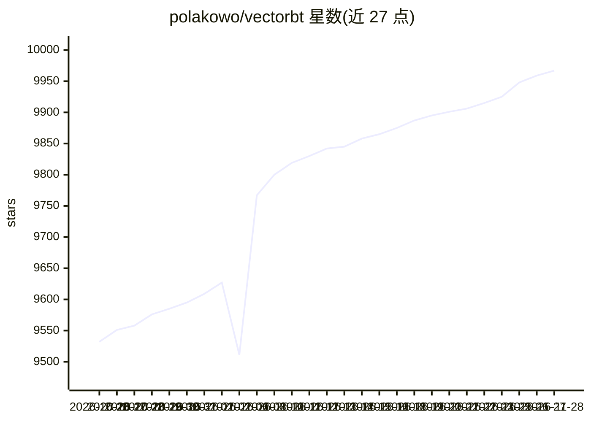

# polakowo/vectorbt

⭐ 9,967 · Python · NOASSERTION · 推送 2026-11-11 · [GitHub](https://github.com/polakowo/vectorbt) · [官网](https://vectorbt.dev) · 个人维护

**面向交易者与研究员的 Python 回测研究工具包**

VectorBT 是用于交易研究的 Python 工具包：探索行情数据、构建指标与信号，跨资产和时间框架比较大量策略想法。基于 pandas/NumPy 与 Numba 加速，提供可选 Rust 引擎；覆盖向量化回测、参数网格扫描、交易/回撤/组合绩效分析、信号工具、walk-forward 优化、Plotly 交互可视化，并支持 Telegram 通知等自动化。为交易者、研究员和 AI agent 设计。为 VectorBT PRO 的开源社区版，PRO 含并行化等更多付费功能。仅限教育用途。

## 筛选速览

| 维度 | 判定 | 备注 |
|---|---|---|
| AI 角色 | `ai-enhanced` | 去掉 AI 部分产品仍成立 |
| 许可风险 | `none` | NOASSERTION |
| 部署形态 | `self-host` | docker 或自建部署 |
| 模型依赖 | — | README 未给出锁定关系 |
| 硬件要求 | — | 无带数字的原话,不猜 |
| 安装摩擦 | `low` | 无编译、无系统依赖或容器化 |
| 成熟度 | — | 结构信号不足 |

## 能力要点

- pandas/NumPy/Numba 向量化回测，支持大规模参数扫描
- 可选 Rust 引擎提供预编译内核免 JIT 编译
- 集成 TA-Lib、Pandas TA、QuantStats，支持 YFData 拉取行情
- Plotly 图表、Jupyter widgets 与浏览器仪表板可视化

## 适用场景

- 批量回测并比较数千个交易策略参数组合
- 分析交易记录、费用、回撤与组合绩效
- 生成机器学习标签与 walk-forward 稳健性测试
- 在 Jupyter 中交互式探索金融时间序列数据

## 场景标签

`金融量化` · 领域:学习与行业

## 证据(README 行号)

> L48:  VectorBT is a Python toolkit for trading research. Explore market data, build indicators and signals, and compare 
> L50: Move from exploring price patterns to evaluating strategies in one workflow. Inspect trades, fees, drawdowns, and p

## 星数曲线

2026-10-26 9,532 → 2026-11-28 9,967（+435）

---
*卡片 v1 · prompt 1.4 · 生成 2026-11-22 · 置信度 mid · 依据 README sha `fb7d2c33d0f2` · [字段定义](../../DATASET.md)*
