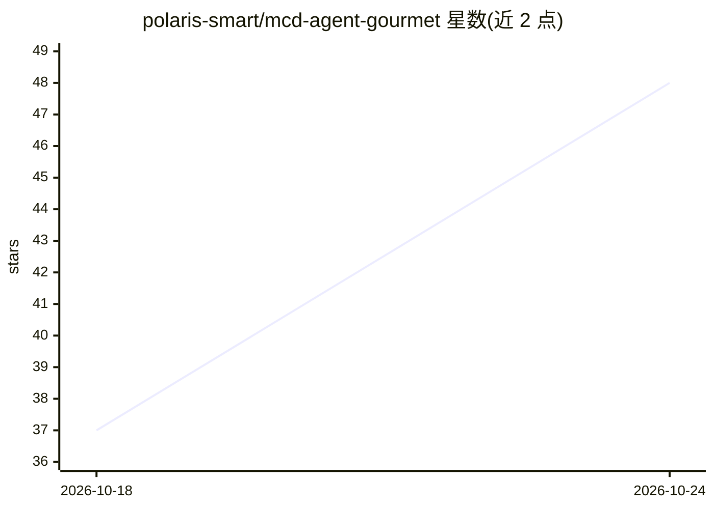

# polaris-smart/mcd-agent-gourmet

⭐ 90 · Python · MIT · 推送 2026-10-24 · [GitHub](https://github.com/polaris-smart/mcd-agent-gourmet) · [官网](https://polaris-smart.github.io/mcd-agent-gourmet/) · 个人维护 · 中文 README

**麦当劳点餐决策工具：用官方核价算清这一餐怎么点最划算**

面向麦当劳中国用户的点餐决策工具：读取麦当劳官方 MCP 的只读数据，按用户预算与口味等硬约束构造完整餐单（主食+小食+饮料，份数按人数），用官方 calculate-price 逐份核价，输出一个答案与可复制点单卡，并对比不同点法的差价；无满足方案时直说并给预算阶梯。提供免登录网页（历史快照）、CLI（Python 3.9+ 零第三方依赖）与 WorkBuddy Skill 三个入口。不下单、不支付、不领券；券条款原文、麦金卡实时权益、份量数据不可查。M-CODE 2026 独立参赛作品，非麦当劳官方产品。

## 筛选速览

| 维度 | 判定 | 备注 |
|---|---|---|
| AI 角色 | `ai-ecosystem` | LLM/agent 周边工具 |
| 许可风险 | `permissive` | MIT |
| 部署形态 | `None` |  |
| 模型依赖 | — | README 未给出锁定关系 |
| 硬件要求 | — | 无带数字的原话,不猜 |
| 安装摩擦 | `low` | 无编译、无系统依赖或容器化 |
| 成熟度 | — | 结构信号不足 |

## 能力要点

- 金额只认官方 calculate-price 返回的整数分，菜单价条件一并说明
- 按人数做份数完备性检查，比较用人均价而非总价
- 无满足方案时直说没有，并给出预算阶梯（差多少加几份可选）
- Python 3.9+ 仅标准库零依赖，网页在浏览器内完成比较不收集凭证

## 适用场景

- 预算有限、口味有明确偏好的个人在到店自取/外带前算清这顿怎么点
- 把钠/能量/蛋白质作为筛选条件筛选餐单
- 在 WorkBuddy 等 AI 客户端里一句话得到可核价餐单
- 开发者学习只读 MCP 客户端与确定性比较的实现

## 场景标签

 · 领域:生活服务/消费决策

## 证据(README 行号)

> L15: > **English TL;DR** — A read-only McDonald's China MCP client + agent skill. Say *"35 yuan, not spicy, regular cola
> L75: ## 它做什么
> L102: 先按官方文档配置麦当劳 MCP 连接器。`mcp-config.example.json` 只含环境变量占位符；若客户端不支持变量展开，请只在该客户端的私有配置中设置实际凭证。

## 星数曲线

2026-10-18 37 → 2026-10-24 48（+11）

---
*卡片 v1 · prompt 1.4 · 生成 2026-10-24 · 置信度 high · 依据 README sha `52da36c4c9e9` · [字段定义](../../DATASET.md)*
