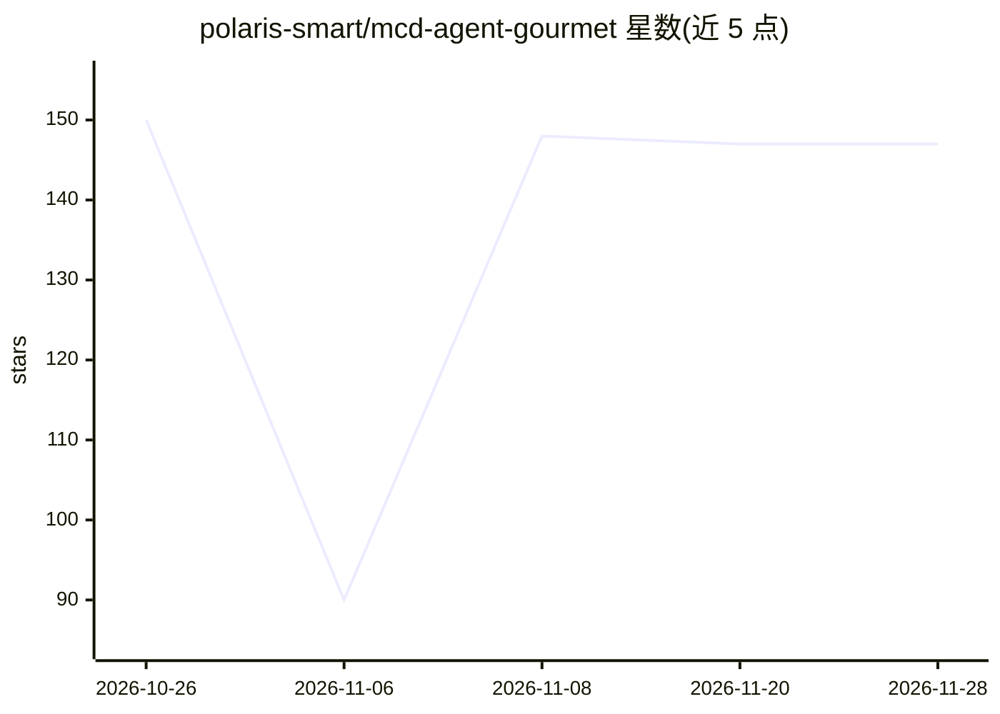

# polaris-smart/mcd-agent-gourmet

⭐ 147 · Python · MIT · 推送 2026-10-25 · [GitHub](https://github.com/polaris-smart/mcd-agent-gourmet) · [官网](https://polaris-smart.github.io/mcd-agent-gourmet/) · 个人维护 · 中文 README

**帮个人用户算清麦当劳点单的 MCP Skill：一句话得核价餐单**

一个只读的麦当劳中国 MCP 客户端 + Agent Skill，接受「35 元，不辣，去冰，带走」式的一句话需求，按价格、钠含量、口味三个标准比较完整餐单（主食+小食+饮料），金额只认官方 calculate-price 返回的整数分，最终产出一张可照着点的点单卡；无方案时直说并给出预算阶梯。不领券、不兑换、不下单、不支付。提供网页（历史快照）、CLI（Python 3.9+ 仅标准库）与 WorkBuddy Skill 三种入口，实时核价需本机配置官方 MCP Token。

## 筛选速览

| 维度 | 判定 | 备注 |
|---|---|---|
| AI 角色 | `ai-native` | 本体是模型或模型工具 |
| 许可风险 | `permissive` | MIT |
| 部署形态 | `None` |  |
| 模型依赖 | — | README 未给出锁定关系 |
| 硬件要求 | — | 无带数字的原话,不猜 |
| 安装摩擦 | `low` | 无编译、无系统依赖或容器化 |
| 成熟度 | — | 结构信号不足 |

## 能力要点

- 金额一律取官方 calculate-price 返回的整数分，并标注附带条件（如随单购麦金卡）
- 确定性筛选与排序，默认只给一个答案，理由为可核对事实
- 点单卡为最终产出物：门店、取餐方式、官方名称、合计
- 零第三方依赖，仅 Python 标准库；Token 只留本机环境变量

## 适用场景

- 下单前算清「这顿多少钱、怎么点更划算」
- 按钠/能量/蛋白质等条件筛选餐单
- 在 WorkBuddy 等 AI 客户端中说一句话得到可核价餐单
- 学习只读 MCP 客户端与失败处理的开发者样板

## 场景标签

`AI 助手` · 领域:对话与助手

## 证据(README 行号)

> L79: “35 元，不辣，有糖可乐去冰，带走。帮我看看附近哪家店合适。”这是我们希望用户直接表达的需求。Skill 会先补齐地点、让你确认门店，再比较完整餐单，不要求普通用户复制门店、商品或券的编码。**这条路径由安装了 Skill 的 
> L171: Python **3.9+**，仅标准库，零第三方依赖。

## 星数曲线

2026-10-26 150 → 2026-11-28 147（-3）

---
*卡片 v1 · prompt 1.4 · 生成 2026-11-27 · 置信度 high · 依据 README sha `70c5d3a0deda` · [字段定义](../../DATASET.md)*
