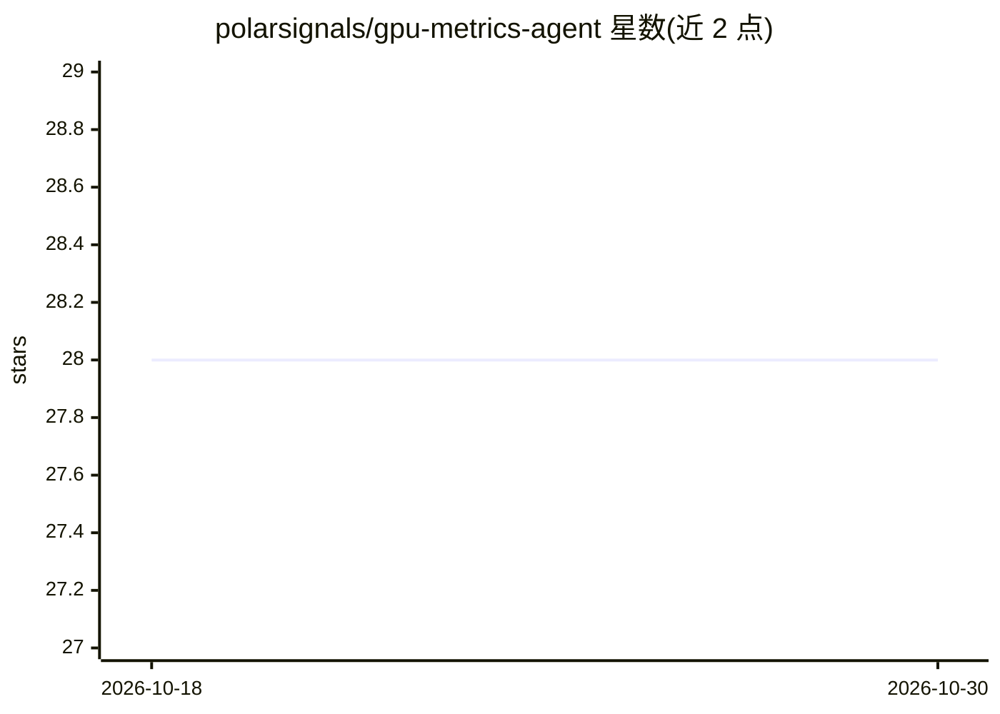

# polarsignals/gpu-metrics-agent

⭐ 28 · Go · Apache-2.0 · 推送 2026-06-24 · [GitHub](https://github.com/polarsignals/gpu-metrics-agent) · [官网](https://www.polarsignals.com/use-cases/gpu-profiling) · 组织维护

**采集 NVIDIA GPU 指标并经 OpenTelemetry 导出的监控代理**

Polar Signals 开发的 GPU 可观测性代理：通过 NVML 采集 GPU 计算与显存利用率、功耗、频率、温度、PCIe 吞吐等指标（部分指标含 pid/comm 进程级属性），按 1s/5s/100ms 不同间隔采集，经 OpenTelemetry Arrow 协议批量导出到 gRPC 远端存储。面向需要 GPU 资源优化、多租户共享监控、成本管理与容量规划的运维/平台团队。要求 Linux、NVIDIA 驱动 390.x 及以上和 NVML；提供 Docker 运行方式，源码为 Go 构建。

## 筛选速览

| 维度 | 判定 | 备注 |
|---|---|---|
| AI 角色 | `ai-ecosystem` | LLM/agent 周边工具 |
| 许可风险 | `permissive` | Apache-2.0 |
| 部署形态 | `self-host` | docker 或自建部署 |
| 模型依赖 | — | README 未给出锁定关系 |
| 硬件要求 | — | 无带数字的原话,不猜 |
| 安装摩擦 | `low` | 无编译、无系统依赖或容器化 |
| 成熟度 | — | 结构信号不足 |

## 能力要点

- 经 NVML 采集利用率/功耗/温度/PCIe 吞吐等指标，采集间隔最短 100ms
- 支持进程级 GPU 指标（pid/comm 属性）用于多租户监控
- 通过 OpenTelemetry Arrow 协议经 gRPC 导出到远程存储

## 适用场景

- 监控共享 GPU 集群中各进程的资源占用
- 基于功耗与利用率数据做成本管理与容量规划
- 排查 GPU 热降频、功率限制与 PCIe 带宽瓶颈

## 场景标签

 · 领域:GPU 可观测性/基础设施监控

## 证据(README 行号)

> L3: A high-performance agent for collecting NVIDIA GPU metrics and exporting them via OpenTelemetry Arrow protocol. Deve
> L95: 1. **NVIDIA Producer**: Interfaces with NVIDIA Management Library (NVML) to collect GPU metrics

## 星数曲线

2026-10-18 28 → 2026-10-30 28（+0）

---
*卡片 v1 · prompt 1.4 · 生成 2026-10-26 · 置信度 high · 依据 README sha `1632ef2e784d` · [字段定义](../../DATASET.md)*
