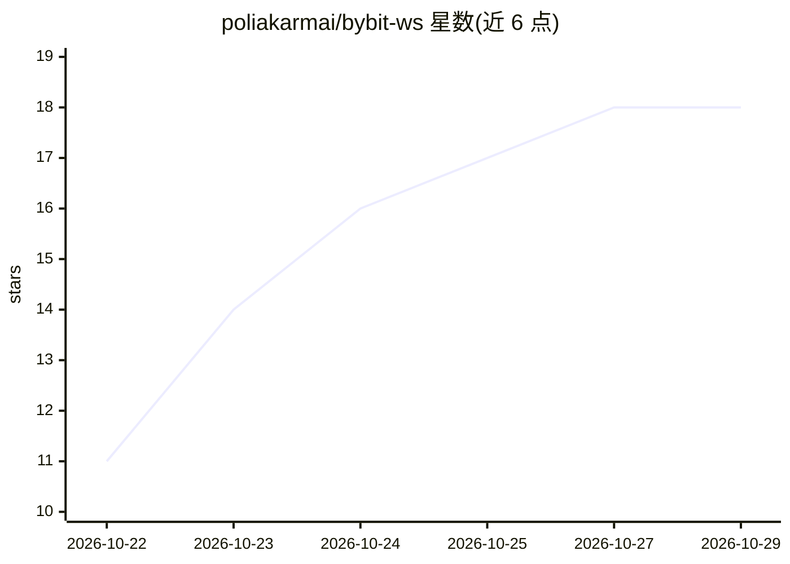

# poliakarmai/bybit-ws

⭐ 18 · Python · AGPL-3.0 · 推送 2026-10-28 · [GitHub](https://github.com/poliakarmai/bybit-ws) · [官网](https://t.me/Gridbolbot) · 个人维护

**面向 Bybit 合约的布林带网格自动交易引擎，带 ML 过滤与 MCP 接口**

Python 编写的 7x24 自动交易引擎：基于 Bollinger Bands 在日线级别做 LONG/SHORT 网格入场，配 9 指标评分（含 LSTM 市场状态分类器）与 Entry Judge 跨模型验证（DeepSeek→Qwen→Nemotron，fail-closed）。风险管理含止损/止盈/追踪/DCA、Circuit Breaker、BlackSwan、相关性拦截、Kill Switch 等。接口提供 RPC API（8766 端口）、JSON-RPC、供 AI agent（Claude Code 等）使用的 MCP Server 与 Telegram 告警。回测用 paper_trade.py，历史收益数据明示不构成收益保证，杠杆最高 10x 且有全损风险提示。面向交易者、量化开发者、信号服务方与团队；AGPL-3.0。README 为俄语。

## 筛选速览

| 维度 | 判定 | 备注 |
|---|---|---|
| AI 角色 | `ai-enhanced` | 去掉 AI 部分产品仍成立 |
| 许可风险 | `viral` | AGPL-3.0 |
| 部署形态 | `library` | 以包/库形式分发 |
| 模型依赖 | — | README 未给出锁定关系 |
| 硬件要求 | — | 无带数字的原话,不猜 |
| 安装摩擦 | `low` | 无编译、无系统依赖或容器化 |
| 成熟度 | — | 结构信号不足 |

## 能力要点

- Bollinger Grid LONG/SHORT 自动交易，9 指标评分含 ML Gate
- LSTM 市场状态分类器（5 类，自述 82.3% 准确率）与 Entry Judge 跨模型验证
- 多层资金保护：Circuit Breaker、BlackSwan、Anti-ludomania、Kill Switch
- RPC API / JSON-RPC / MCP Server / Telegram 告警多种接入方式

## 适用场景

- 在 VPS 上 7x24 自动交易 Bybit 合约并接收 Telegram 告警
- 通过 RPC/MCP 接口让 AI agent 或自研机器人控制交易
- 用 paper_trade 在历史数据上回测自己的参数

## 场景标签

`金融量化` · 领域:学习与行业

## 证据(README 行号)

> L12: Автономный трейдинг-движок, который:
> L73: - **Авто-входы** с MTF-подтверждением, orderbook-анализом и Entry Judge (DeepSeek → Qwen → Nemotron, fail-closed)
> L93: - **MCP Server** для AI-агентов (Claude Code, Hermes, Codex)

## 星数曲线

2026-10-22 11 → 2026-10-29 18（+7）

---
*卡片 v1 · prompt 1.4 · 生成 2026-10-29 · 置信度 mid · 依据 README sha `872ba63dfda3` · [字段定义](../../DATASET.md)*
