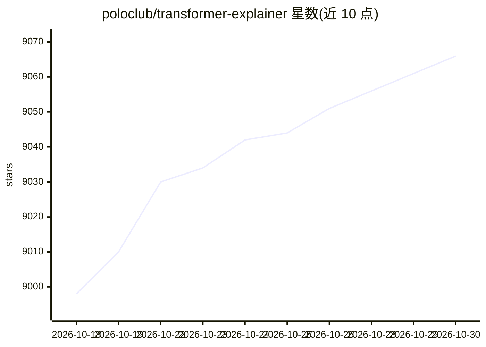

# poloclub/transformer-explainer

⭐ 9,066 · JavaScript · MIT · 推送 2026-06-06 · [GitHub](https://github.com/poloclub/transformer-explainer) · [官网](https://poloclub.github.io/transformer-explainer/) · 组织维护

**浏览器内交互式可视化讲解 GPT/Transformer 工作原理的工具**

由佐治亚理工学院团队开发的交互式学习工具：在浏览器中运行 GPT-2 模型，用户可输入自己的文本，实时观察 Transformer 内部组件（如注意力等）如何协作预测下一个 token。提供在线 Demo、YouTube 演示视频与 CHI 2026 论文；本地运行需 Node.js v20+ 与 NPM v10+，通过 git clone 后 npm install/run dev 启动。MIT 许可。

## 筛选速览

| 维度 | 判定 | 备注 |
|---|---|---|
| AI 角色 | `ai-knowledge` | 知识聚合/清单类 |
| 许可风险 | `permissive` | MIT |
| 部署形态 | `library` | 以包/库形式分发 |
| 模型依赖 | — | README 未给出锁定关系 |
| 硬件要求 | — | 无带数字的原话,不猜 |
| 安装摩擦 | `low` | 无编译、无系统依赖或容器化 |
| 成熟度 | — | 结构信号不足 |

## 能力要点

- 浏览器内运行实时 GPT-2 模型
- 输入自定义文本并实时观察内部组件运作
- 提供在线 Demo、演示视频与 CHI 2026 论文

## 适用场景

- 通过交互实验理解 GPT/Transformer 的预测机制
- 教学或自学深度学习时作为可视化辅助材料

## 场景标签

`教程课程` · 领域:学习与行业

## 证据(README 行号)

> L3: Transformer Explainer is an interactive visualization tool designed to help anyone learn how Transformer-based model
> L13: **Transformer Explainer: Learning LLM Transformers with Interactive Visual Explanation and Experimentations**.

## 星数曲线

2026-10-18 8,998 → 2026-10-30 9,066（+68）

---
*卡片 v1 · prompt 1.4 · 生成 2026-10-20 · 置信度 high · 依据 README sha `39cda1a01bb0` · [字段定义](../../DATASET.md)*
