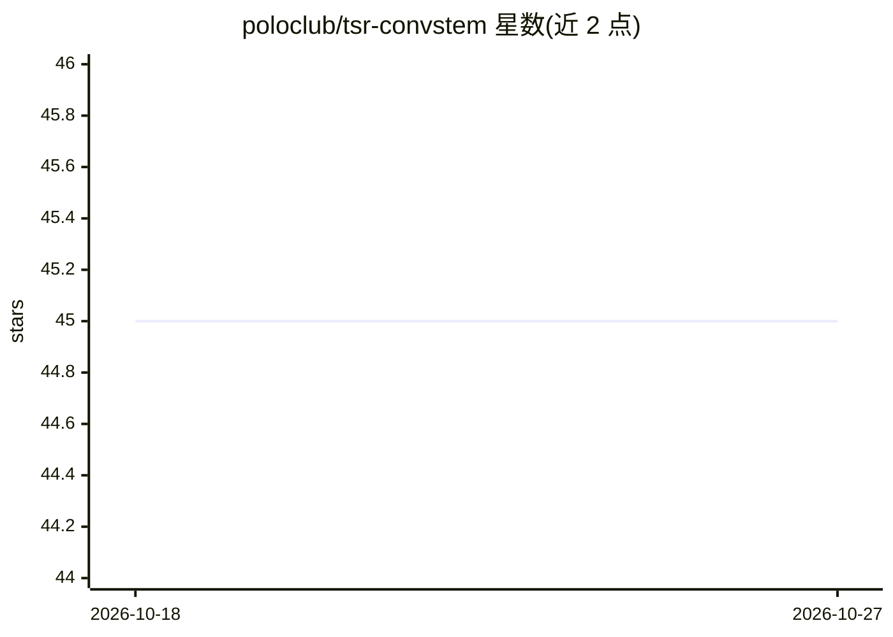

# poloclub/tsr-convstem

⭐ 45 · Python · MIT · 推送 2026-04-21 · [GitHub](https://github.com/poloclub/tsr-convstem) · [官网](https://arxiv.org/abs/2311.05565) · 组织维护

**表格结构识别模型的轻量卷积视觉编码器研究代码**

NeurIPS 2023 表格表示学习 Workshop（Oral）论文的官方代码：研究用卷积 stem 替代经典 CNN backbone 作为 TSR 模型的视觉编码器，论证其以更简单模型匹配 CNN 性能，平衡感受野比例与序列长度。训练与测试通过 Makefile 驱动，需自行准备 PubTabNet 数据集并配置路径，消融实验配置在 Makefile 中定义。README 未提供预训练权重或推理示例。

## 筛选速览

| 维度 | 判定 | 备注 |
|---|---|---|
| AI 角色 | `ai-native` | 本体是模型或模型工具 |
| 许可风险 | `permissive` | MIT |
| 部署形态 | `None` |  |
| 模型依赖 | — | README 未给出锁定关系 |
| 硬件要求 | — | 无带数字的原话,不猜 |
| 安装摩擦 | `low` | 无编译、无系统依赖或容器化 |
| 成熟度 | — | 结构信号不足 |

## 能力要点

- 提出用卷积 stem 替代 CNN backbone 的 TSR 视觉编码器
- 训练、测试与 TEDS 评估均通过 make 命令执行
- 消融实验配置在 Makefile 的 Experiment Configurations 段定义

## 适用场景

- 复现论文中卷积 stem 的 TSR 训练与评估
- 在 PubTabNet 上对比不同视觉编码器配置
- 研究感受野与序列长度对表格识别的影响

## 场景标签

`模型训练` `文档解析` · 领域:知识与检索

## 证据(README 行号)

> L6: High-Performance Transformers for Table Structure Recognition Need Early Convolutions. ShengYun Peng, Seongmin Lee, 
> L13: Table structure recognition (TSR) aims to convert tabular images into a machine-readable format, where a visual enc

## 星数曲线

2026-10-18 45 → 2026-10-27 45（+0）

---
*卡片 v1 · prompt 1.4 · 生成 2026-10-25 · 置信度 high · 依据 README sha `85f6fd3714a1` · [字段定义](../../DATASET.md)*
