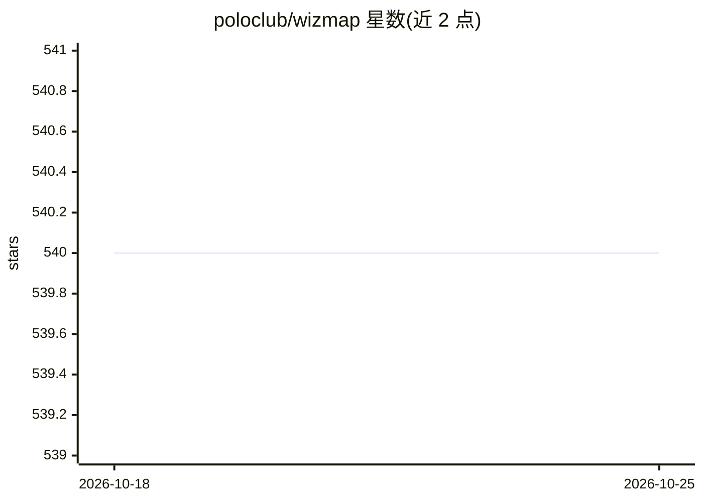

# poloclub/wizmap

⭐ 540 · TypeScript · MIT · 推送 2026-01-22 · [GitHub](https://github.com/poloclub/wizmap) · [官网](https://poloclub.github.io/wizmap/) · 组织维护

**在浏览器中交互探索大规模机器学习嵌入的的可视化工具**

Georgia Tech Polo Club 出品的嵌入可视化工具：通过多分辨率嵌入摘要方法，将百万级嵌入点以类地图交互在浏览器中呈现，支持文本与图像多模态数据、嵌入快速检索、动画式嵌入演化展示，并可在 Jupyter/Colab/VS Code 笔记本中通过 Python 库两个函数调用生成摘要 JSON 后直接可视化，或通过 URL 分享嵌入地图。使用自有嵌入需先安装 wizmap Python 库；Web 端开发需 git clone 仓库并用 npm 安装依赖运行。配套论文发表于 ACL'23 System Demonstration。

## 筛选速览

| 维度 | 判定 | 备注 |
|---|---|---|
| AI 角色 | `ai-ecosystem` | LLM/agent 周边工具 |
| 许可风险 | `permissive` | MIT |
| 部署形态 | `library` | 以包/库形式分发 |
| 模型依赖 | — | README 未给出锁定关系 |
| 硬件要求 | — | 无带数字的原话,不猜 |
| 安装摩擦 | `low` | 无编译、无系统依赖或容器化 |
| 成熟度 | — | 结构信号不足 |

## 能力要点

- 可扩展至百万级嵌入点的交互探索
- 多分辨率嵌入摘要与快速嵌入检索
- 支持文本与图像多模态数据及动画式嵌入演化
- 兼容 Jupyter/Colab/VS Code 笔记本，两个函数调用即可生成可视化数据

## 适用场景

- 我想在浏览器里探索和解读自己模型的嵌入空间
- 我想向合作者通过 URL 分享嵌入地图
- 我想在 Colab/Jupyter 笔记本中直接可视化嵌入

## 场景标签

 · 领域:机器学习可视化

## 证据(README 行号)

> L21: WizMap is a scalable interactive visualization tool to help you easily explore large machine learning embeddings. W
> L88: To use WizMap with your embeddings, you first need to install the `wizmap` Python library.
> L117: To learn more about WizMap, please read our research paper (published at ACL'23 System Demonstration).

## 星数曲线

2026-10-18 540 → 2026-10-25 540（+0）

---
*卡片 v1 · prompt 1.4 · 生成 2026-10-21 · 置信度 high · 依据 README sha `a3ee334bae78` · [字段定义](../../DATASET.md)*
