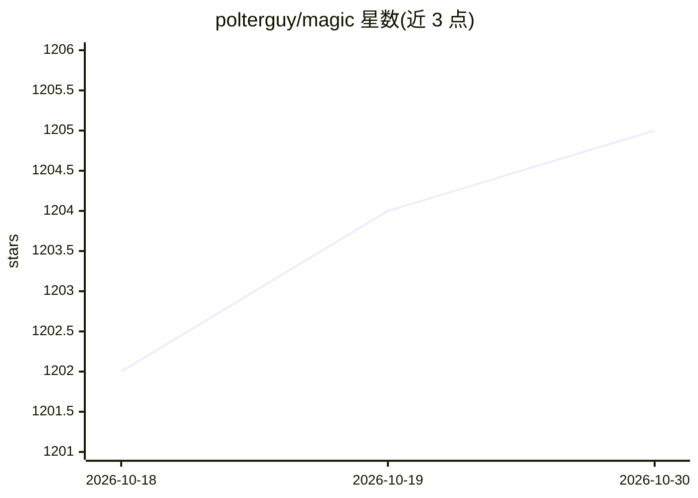

# polterguy/magic

⭐ 1,205 · C# · MIT · 推送 2026-10-29 · [GitHub](https://github.com/polterguy/magic) · [官网](https://hyperlambda.dev) · 个人维护

**面向开发者的低代码全栈应用与 AI Agent 生成平台**

基于 .NET/Hyperlambda 的自托管全栈应用平台：通过自然语言生成数据库、安全 API、业务逻辑与前端，指向现有 MySQL/PostgreSQL/SQL Server/MariaDB 库即可生成 CRUD REST 端点。内置 MCP 服务器，将每个端点暴露为 Claude、Cursor、Codex 等客户端可调用的工具；Hyperlambda 以 AST 方式生成，未声明的函数调用会在执行前被拒绝。自带仪表盘（Hyper IDE、SQL Studio、Web Designer、Chat Ops），保存即运行、无部署步骤，Hyperlambda 运行于沙箱并有 RBAC 函数白名单。以 Docker Compose 方式运行。

## 筛选速览

| 维度 | 判定 | 备注 |
|---|---|---|
| AI 角色 | `ai-native` | 本体是模型或模型工具 |
| 许可风险 | `permissive` | MIT |
| 部署形态 | `self-host` | docker 或自建部署 |
| 模型依赖 | locked-api |  |
| 硬件要求 | — | 无带数字的原话,不猜 |
| 安装摩擦 | `low` | 无编译、无系统依赖或容器化 |
| 成熟度 | — | 结构信号不足 |

## 能力要点

- 自然语言生成全栈应用：数据库、安全 API、业务逻辑与前端
- 内置 MCP 服务器，端点自动成为 AI 客户端可调用的工具
- Hyperlambda 以 AST 生成，不存在/未授权的函数调用在执行前被拒绝
- Hyperlambda 沙箱执行与 RBAC 函数白名单、按角色限速与超时

## 适用场景

- 从现有数据库快速生成带认证的安全 CRUD API
- 把自有端点通过 MCP 暴露给 Claude、Cursor 等 AI 客户端
- 用自然语言搭建 CRM、后台管理等内部业务系统
- 用网站内容训练并部署可嵌入的聊天机器人

## 场景标签

`代码生成` `聊天机器人` · 领域:编码与开发

## 证据(README 行号)

> L3: Turn plain English into a working full-stack app — database, secure API, business logic, and frontend — running on *
> L29: * **Full-stack business apps** — CRM systems, admin panels, booking systems, internal tools; database, secure API a
> L64: Install the `mcp` plugin, point Claude Code, Cowork, or OpenAI's Codex at your cloudlet, and every HTTP endpoint in

## 星数曲线

2026-10-18 1,202 → 2026-10-30 1,205（+3）

---
*卡片 v1 · prompt 1.4 · 生成 2026-10-21 · 置信度 high · 依据 README sha `84a7a5ced324` · [字段定义](../../DATASET.md)*
