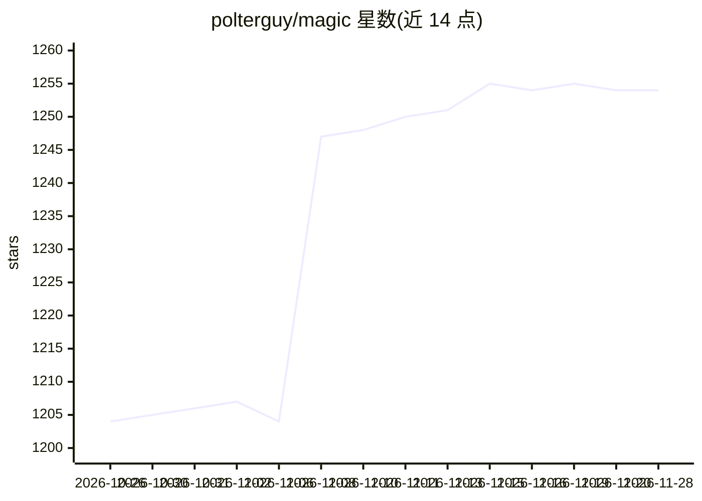

# polterguy/magic

⭐ 1,254 · C# · MIT · 推送 2026-11-27 · [GitHub](https://github.com/polterguy/magic) · [官网](https://hyperlambda.dev) · 个人维护

**从自然语言生成全栈应用与 AI Agent 的低代码平台**

基于 .NET 与 Hyperlambda 的开源低代码平台：将英文描述转为数据库、安全 REST API、业务逻辑与前端，全部运行在用户自有硬件上。内置 Dashboard 提供 Hyper IDE、SQL Studio、API/端点生成器、Web Designer、Chat Ops 等模块；Hyperlambda 以 AST 形式生成代码并按函数白名单做沙箱执行，配合 RBAC 控制调用权限。安装 MCP 插件后，平台端点可作为工具暴露给 MCP 客户端，并支持将网站爬取内容转为嵌入式聊天机器人的训练数据。MIT 许可，Docker 一键启动。

## 筛选速览

| 维度 | 判定 | 备注 |
|---|---|---|
| AI 角色 | `ai-ecosystem` | LLM/agent 周边工具 |
| 许可风险 | `permissive` | MIT |
| 部署形态 | `self-host` | docker 或自建部署 |
| 模型依赖 | — | README 未给出锁定关系 |
| 硬件要求 | — | 无带数字的原话,不猜 |
| 安装摩擦 | `low` | 无编译、无系统依赖或容器化 |
| 成熟度 | — | 结构信号不足 |

## 能力要点

- 从自然语言生成数据库、REST API、业务逻辑与前端
- MCP 插件将端点转为 Claude/Cursor/Codex 等客户端可调用的工具
- Hyperlambda AST 级生成与执行层函数白名单沙箱
- 基于 Gemma 微调模型的代码生成器，自报 401 项测试通过 79.2%

## 适用场景

- 为既有 MySQL/PostgreSQL/SQL Server 数据库快速生成 CRUD API
- 构建可查询自有数据库、走自有 RBAC 的数据库驱动 AI Agent
- 爬取网站内容生成可嵌入的自有内容聊天机器人
- 粘贴 OpenAPI/Swagger 规范生成第三方 API 的包装端点

## 场景标签

`代码生成` `聊天机器人` `Agent 框架` · 领域:Agent 开发

## 证据(README 行号)

> L3: Turn plain English into a working full-stack app — database, secure API, business logic, and frontend — running on *
> L36: * **Database-driven AI agents** — agents that query and update *your* database and invoke *your* endpoints, behind 
> L86: The sidebar is the whole platform: **Hyper IDE** for editing, running and *replaying* any file on the server, **Pla

## 星数曲线

2026-10-26 1,204 → 2026-11-28 1,254（+50）

---
*卡片 v1 · prompt 1.4 · 生成 2026-11-26 · 置信度 high · 依据 README sha `4d332ae4e9eb` · [字段定义](../../DATASET.md)*
