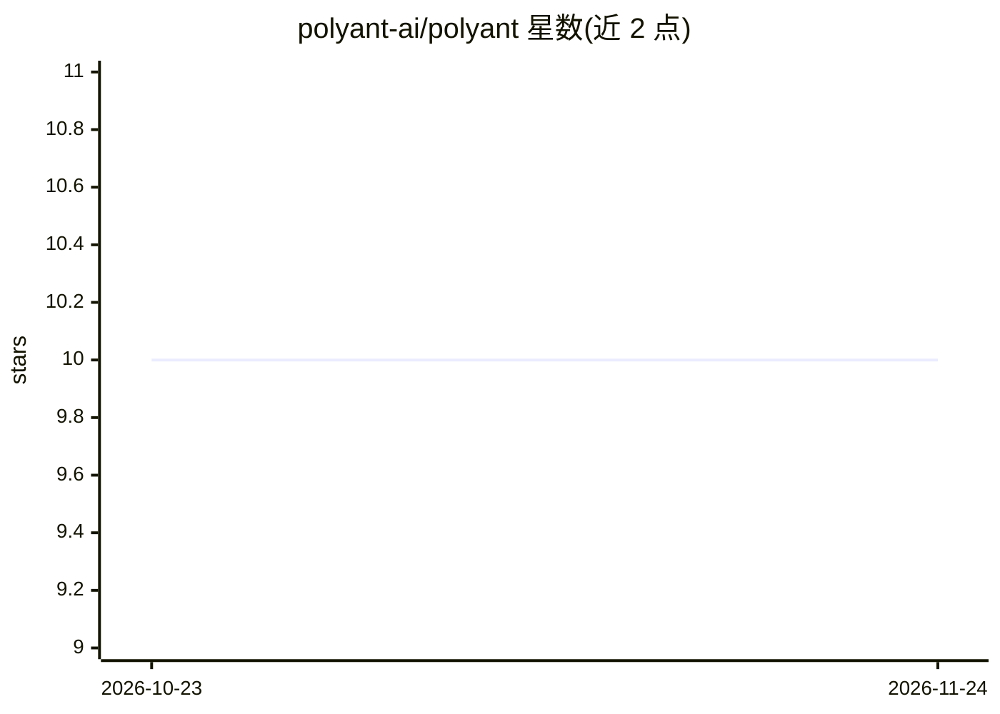

# polyant-ai/polyant

⭐ 10 · TypeScript · AGPL-3.0 · 推送 2026-11-23 · [GitHub](https://github.com/polyant-ai/polyant) · [官网](https://polyant.ai) · 组织维护

**企业级多 Agent 运行平台：把 Agent 接入业务流程**

Exelab 开发的开源企业 AI 平台（AGPL-3.0-or-later），提供多 Agent 系统的完整运行时：NestJS 引擎、Next.js 管理面板与 OpenAI 兼容 API。核心机制包括 Supervisor 编排、pgvector+FTS 混合检索的长期记忆与知识库、Telegram/Slack/WhatsApp/Web 多渠道接入、MCP Client 与 A2A 协议、插件式工具系统、RBAC 多租户与逐实例密钥加密。要求 Node.js 24+、Docker 与 PostgreSQL（含 pgvector），通过 git clone 与 docker compose 启动。

## 筛选速览

| 维度 | 判定 | 备注 |
|---|---|---|
| AI 角色 | `ai-ecosystem` | LLM/agent 周边工具 |
| 许可风险 | `viral` | AGPL-3.0 |
| 部署形态 | `self-host` | docker 或自建部署 |
| 模型依赖 | locked-api |  |
| 硬件要求 | — | 无带数字的原话,不猜 |
| 安装摩擦 | `low` | 无编译、无系统依赖或容器化 |
| 成熟度 | — | 结构信号不足 |

## 能力要点

- Supervisor Agent 编排与多实例管理，实例经 OpenAI 兼容 API 暴露为可选模型
- pgvector 余弦相似度 + PostgreSQL FTS 经 RRF 融合的长期记忆
- MCP Client（none/static/oauth 三种认证）与 A2A 协议服务器
- RBAC 十ancy模型（Organization→Workspace→Agent）与 AES-256-GCM 逐实例加密

## 适用场景

- 把 AI Agent 接入企业的 Telegram/Slack/WhatsApp 客户沟通渠道
- 在组织内部署带权限管理与成本统计的多 Agent 助手
- 通过插件 SDK 为业务系统编写专属工具
- 用 MCP 服务器为 Agent 扩展外部工具能力

## 场景标签

`多智能体` `聊天机器人` · 领域:Agent 开发

## 证据(README 行号)

> L11: **Polyant** is an enterprise AI platform by Exelab for putting agents to work in business processes, at scale. It i
> L33: - **Supervisor Agent** — Central orchestrator with tool use, up to 15 reasoning steps per request (Vercel AI SDK)
> L36: - **Provider-agnostic** — Switch between OpenAI, Anthropic, Amazon Bedrock, and Nebius Token Factory per agent from

## 星数曲线

2026-10-23 10 → 2026-11-24 10（+0）

---
*卡片 v1 · prompt 1.4 · 生成 2026-11-19 · 置信度 high · 依据 README sha `a1986be50d6b` · [字段定义](../../DATASET.md)*
