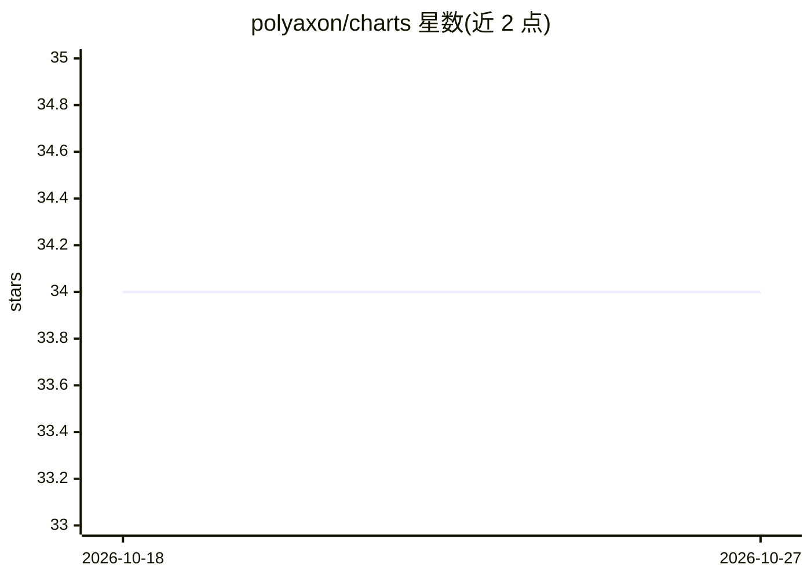

# polyaxon/charts

⭐ 34 · Go Template · Apache-2.0 · 推送 2026-10-21 · [GitHub](https://github.com/polyaxon/charts) · [官网](https://charts.polyaxon.com) · 组织维护

**在 Kubernetes 上部署 Polyaxon 及训练算子的 Helm charts 集合**

Polyaxon 官方维护的 Helm charts 仓库，提供三类 chart：自托管 Polyaxon 平台、配合 Polyaxon 云/企业版部署的 agent，以及分布式训练算子（TFJob/PytorchJob/MPIJob）。安装流程为配置 Helm、创建 Kubernetes namespace、添加 charts 仓库后 helm install。平台 chart 内置 PostgreSQL 子 chart（建议自带实例），部署调度器或企业版还需 Redis；多节点集群需提供 ReadWriteMany 卷或云 bucket 作为 artifacts 存储。面向使用 Kubernetes 运行 Polyaxon 的 MLOps 团队。

## 筛选速览

| 维度 | 判定 | 备注 |
|---|---|---|
| AI 角色 | `ai-ecosystem` | LLM/agent 周边工具 |
| 许可风险 | `permissive` | Apache-2.0 |
| 部署形态 | `library` | 以包/库形式分发 |
| 模型依赖 | — | README 未给出锁定关系 |
| 硬件要求 | — | 无带数字的原话,不猜 |
| 安装摩擦 | `low` | 无编译、无系统依赖或容器化 |
| 成熟度 | — | 结构信号不足 |

## 能力要点

- 自托管 Polyaxon 平台、agent 与分布式训练算子三类 Helm chart
- 支持 TFJob/PytorchJob/MPIJob 分布式训练任务安装
- 平台 chart 打包 PostgreSQL 依赖，可自带实例替换

## 适用场景

- 在自有 Kubernetes 集群上部署自托管 Polyaxon
- 配合 Polyaxon 云或企业版部署 agent
- 安装分布式训练算子运行 PyTorch/TensorFlow/MPI 训练任务

## 场景标签

`MLOps` · 领域:训练与推理

## 证据(README 行号)

> L10: Polyaxon charts is a set of Helm charts for creating reproducible and maintainable deployments of Polyaxon and it's
> L16:  * Helm charts for distributed training operators.

## 星数曲线

2026-10-18 34 → 2026-10-27 34（+0）

---
*卡片 v1 · prompt 1.4 · 生成 2026-10-25 · 置信度 high · 依据 README sha `6cc0609aa000` · [字段定义](../../DATASET.md)*
