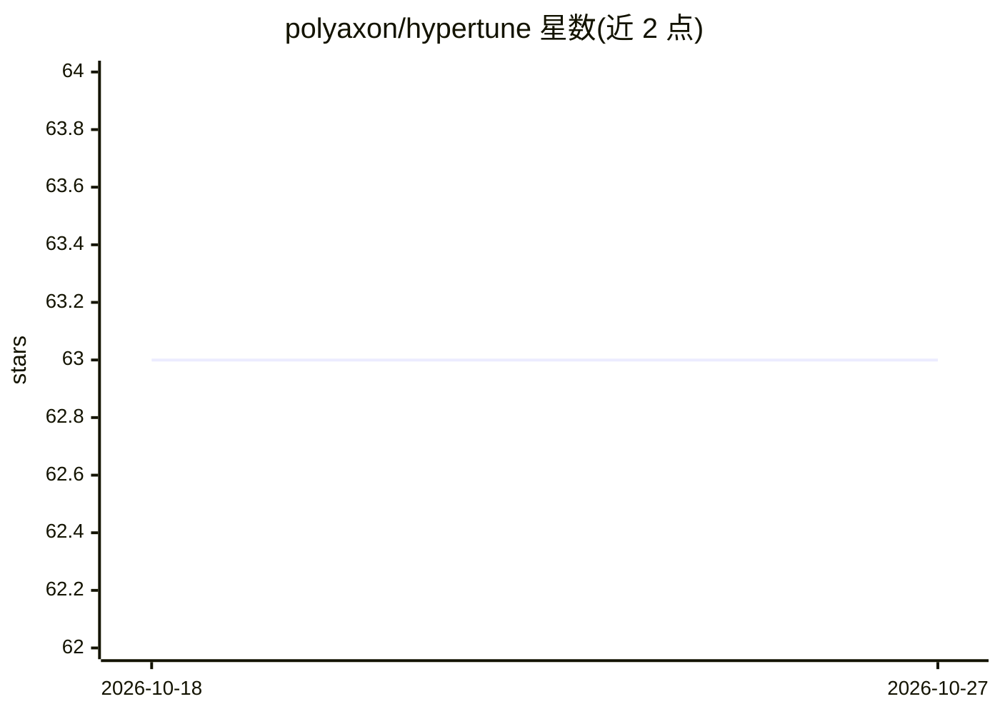

# polyaxon/hypertune

⭐ 63 · Python · Apache-2.0 · 推送 2026-10-21 · [GitHub](https://github.com/polyaxon/hypertune) · [官网](https://docs.polyaxon.com/) · 组织维护

**面向机器学习工作流的超参数优化库**

Polyaxon 旗下的 hypertune 是一个执行超参数优化的 Python 库，服务于机器学习与深度学习的调参场景，主题标签涵盖 scikit-learn、MLOps、工作流等。安装方式为 pip install polyaxon hypertune，采用 Apache 2 许可证。README 仅含简要说明与安装命令，未展示支持的搜索算法、后端集成或使用示例等细节，具体能力需查阅其文档（Docs 链接）确认。

## 筛选速览

| 维度 | 判定 | 备注 |
|---|---|---|
| AI 角色 | `ai-ecosystem` | LLM/agent 周边工具 |
| 许可风险 | `permissive` | Apache-2.0 |
| 部署形态 | `library` | 以包/库形式分发 |
| 模型依赖 | — | README 未给出锁定关系 |
| 硬件要求 | — | 无带数字的原话,不猜 |
| 安装摩擦 | `low` | 无编译、无系统依赖或容器化 |
| 成熟度 | — | 结构信号不足 |

## 能力要点

- 提供超参数优化功能（hyperparameter optimization）
- 以 Python 库形式发布，pip 一行安装
- Apache 2 许可证

## 适用场景

- 为机器学习/深度学习模型做超参数调优
- 集成到 MLOps 工作流中执行调参任务

## 场景标签

`MLOps` · 领域:训练与推理

## 证据(README 行号)

> L10: A library for performing hyperparameter optimization.
> L15: pip install polyaxon hypertune

## 星数曲线

2026-10-18 63 → 2026-10-27 63（+0）

---
*卡片 v1 · prompt 1.4 · 生成 2026-10-24 · 置信度 mid · 依据 README sha `68c23e48e084` · [字段定义](../../DATASET.md)*
